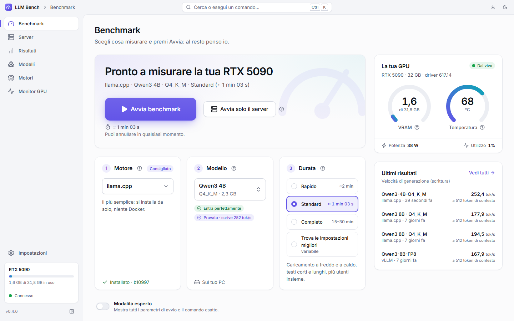
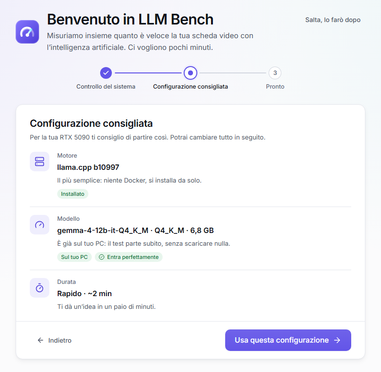
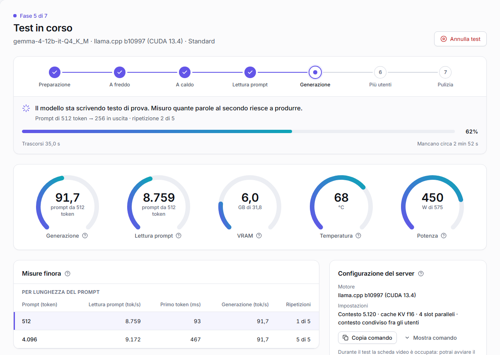
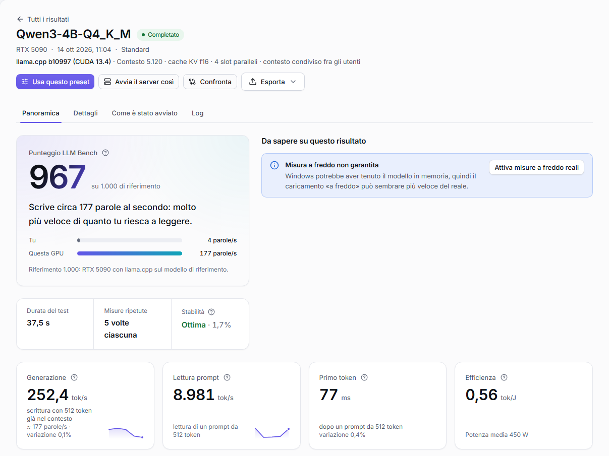
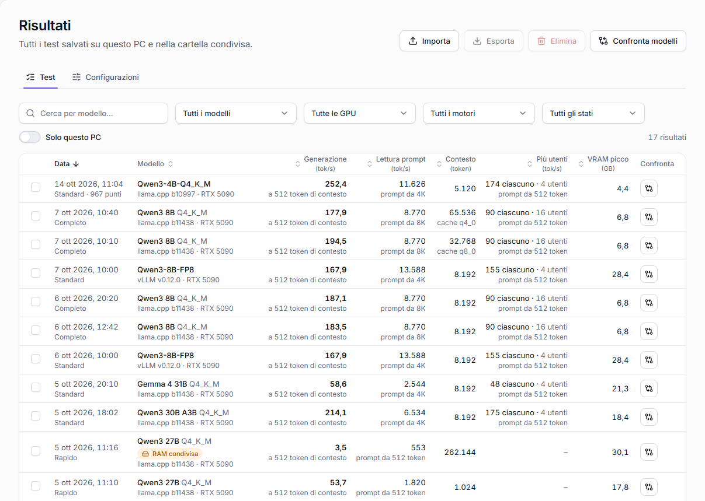
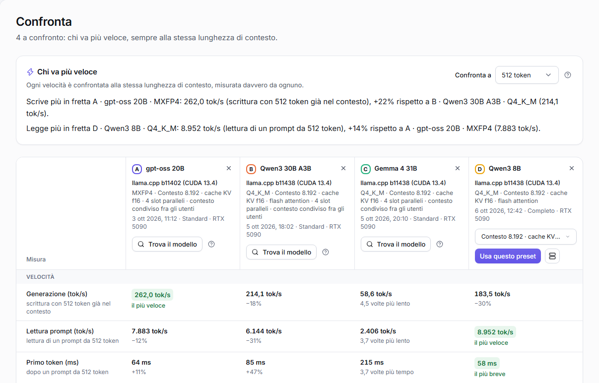
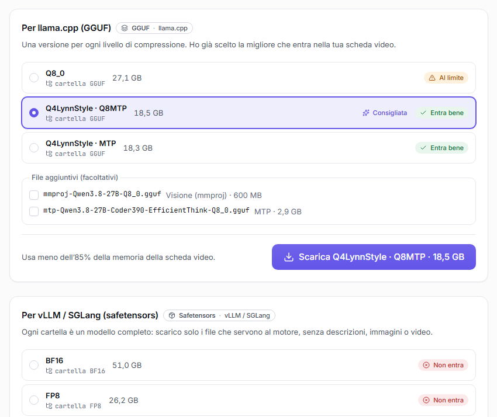
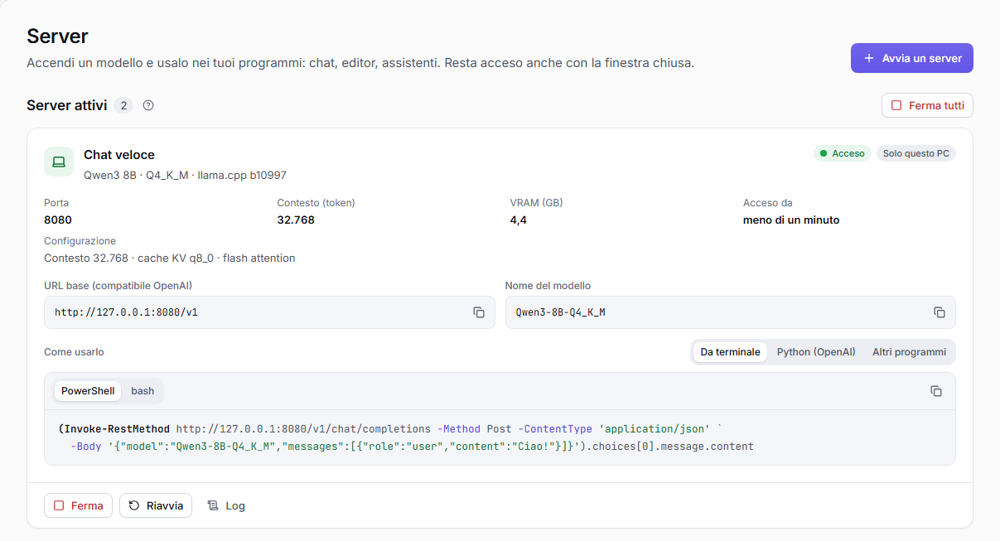
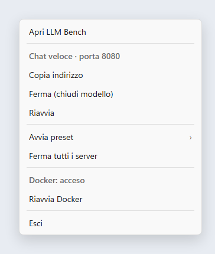
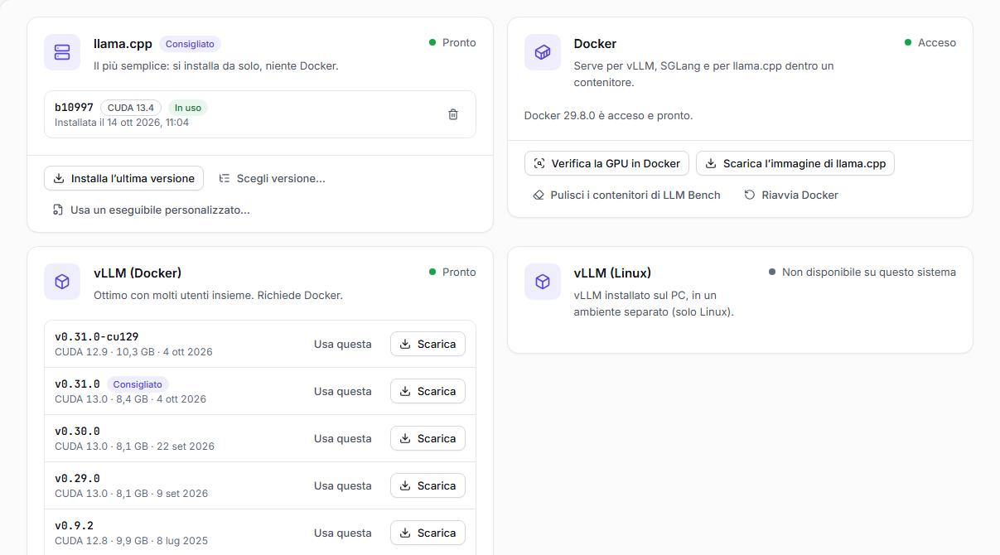

<p align="center"></p>

<h1 align="center">LLM Bench</h1>

<p align="center"><b>How fast is your NVIDIA graphics card at running AI?</b><br>
LLM Bench puts it to the test with language models on your own PC and answers in plain words.</p>

<p align="center"><a href="README.md">Italiano</a> · <a href="docs/GUIDA.md">Full guide (Italian)</a></p>

<picture>
  <source media="(prefers-color-scheme: dark)" srcset="docs/screenshots/benchmark-dark.png">
  
</picture>

A **language model** (LLM) is the "brain" behind programs like ChatGPT. Many can be downloaded and run on your own PC: LLM Bench tells you how well your graphics card does it. It runs on **Windows and Linux**; the app speaks Italian (the default) and English, and the screenshots below show the Italian interface.

You don't need to know anything technical: LLM Bench installs what is missing by itself and always asks before downloading anything.

## What it does

- **Measures your graphics card** with the models you pick: how long they take to load, how fast they read and write, how long you wait for the first word, how they cope with several people at once, how much video memory and power they use.
- **Explains the numbers in words**, for example "It writes about 177 words per second: much faster than you can read".
- **Finds the best settings** on its own and tells you which combination is fastest and how much text your card can hold.
- **Compares** tests and models side by side, always under the same conditions.
- **Finds and downloads models** from Hugging Face and tells you up front whether they **fit in your card**.
- **Keeps a model running** for your own programs (chats, editors, assistants), even with the window closed, from the notification area.
- **Works with several engines** (the programs that run the models): llama.cpp, vLLM, SGLang, NInfer and modified versions. It installs and updates them with one button.

## What you need

- An **NVIDIA graphics card** with its **driver**. If the driver is missing or too old, LLM Bench says so and opens the right download page.
- **Windows 10 or 11** (64-bit) or **Linux** (Ubuntu, Debian and derivatives; the AppImage runs on other distributions too).
- Some disk space for the models: a few GB for the small ones, tens of GB for the large ones.

That's all: LLM Bench downloads and sets up the llama.cpp engine at the first test. Optional, only for some engines: **Docker** for vLLM and SGLang (on Windows, Docker Desktop: LLM Bench installs and starts it), and **WSL 2** with a Linux distribution to use NInfer on Windows.

## Installing

> **Where are the installers?** Once versions are published, they will be on this repository's **Releases** page. For now, build them from the source with `npm run dist` (see [For developers](#for-developers)).

**Windows.** Open `LLM-Bench-Setup-x.y.z.exe`, pick the language, keep the proposed folder and press **Install**. Windows asks once for administrator permission: LLM Bench installs into *Program Files* for every user of the PC. It uninstalls like any program, from Settings → **Apps** → **Installed apps**; your results stay in `%APPDATA%\LLM Bench`. If Windows shows "Windows protected your PC", click **More info** → **Run anyway**. There is also a **portable** version, `LLM-Bench-x.y.z-portable.exe`, that runs without installing.

**Linux.** The **.deb** package (Ubuntu, Debian and derivatives) installs with `sudo apt install ./llm-bench-x.y.z-amd64.deb` and uninstalls with `sudo apt remove llm-bench`. The **AppImage** runs anywhere: `chmod +x llm-bench-x.y.z-x86_64.AppImage`, then open it.

## Your first test in 3 steps

**1. Open LLM Bench.** The first time it checks your PC (driver, graphics card, free space) and suggests where to start: the llama.cpp engine, a model that fits your card and a two-minute *Quick* test. Anything missing has a button next to it that fixes it.

<p align="center"><picture>
  <source media="(prefers-color-scheme: dark)" srcset="docs/screenshots/primo-avvio-dark.png">
  
</picture></p>

**2. Press "Start benchmark".** If something must be downloaded first, LLM Bench tells you what and how big, and waits for your OK. During the test you see how far along it is, the speed, video memory, temperature and watts. You can cancel at any time.

<picture>
  <source media="(prefers-color-scheme: dark)" srcset="docs/screenshots/test-in-corso-dark.png">
  
</picture>

**3. Read the result.** At the top, the score and a sentence that explains it; below, every number with its meaning. Coloured boxes tell you when something may have skewed the measurement, and how to fix it.

<picture>
  <source media="(prefers-color-scheme: dark)" srcset="docs/screenshots/risultato-dark.png">
  
</picture>

## Understanding the results

| Number | What it means |
|---|---|
| **Generation** (tok/s) | How fast the model **writes**. A *token* is a piece of a word: 100 tokens are about 70 words |
| **Prompt reading** (tok/s) | How fast it **reads** what you give it: the question, a document, code |
| **First token** (ms) | How long you wait for the first word. Under 200 ms it feels instant |
| **Cold / warm load** | How long it takes to open the model: from disk the first time, or when the PC already holds it in memory |
| **Peak VRAM** | The most video memory it used |
| **Several users** | How much it writes in total, and per person, when several people use it at once |
| **Efficiency** (tok/J) | Work per unit of energy: higher means it uses less power |
| **LLM Bench score** | One number to compare cards: 1,000 is an RTX 5090 with llama.cpp on the reference model. Only a Standard test of that model gets one |

**Every speed says how much text it was measured with.** A model slows down when it already has a lot of text in front of it (the *context*), so LLM Bench never shows a bare number: you always read "writing with 32,768 tokens already in context" or "reading a 512-token prompt". Two speeds only compare at the same length, and Compare does that for you.

<picture>
  <source media="(prefers-color-scheme: dark)" srcset="docs/screenshots/risultati-dark.png">
  
</picture>

## Comparing models

Press **Compare** next to a test, or **Compare models** on the Results page and pick 2 to 4: for each one LLM Bench takes the fastest configuration measured on your card. A sentence on top tells you who writes and who reads faster, and by how much; below, each measurement highlights the best and puts the others in words ("2.2 times slower", "−16%").

<picture>
  <source media="(prefers-color-scheme: dark)" srcset="docs/screenshots/confronta-dark.png">
  
</picture>

## Finding and downloading models

The **Models** page lists the models already on your PC (LM Studio, Ollama and Hugging Face folders included), the ones recommended for your card and the Hugging Face search. Each model comes in several **versions**: LLM Bench picks the best one that fits (**Recommended**) and labels each with a verdict, from **Fits perfectly** to **Does not fit**.

<p align="center"><picture>
  <source media="(prefers-color-scheme: dark)" srcset="docs/screenshots/modello-versioni-dark.png">
  
</picture></p>

## Keeping a server running

Open **Servers** → **Start a server** to run a model for your own programs, without a test. Each server shows its **OpenAI-compatible address** and **model name** to copy, with ready examples for the terminal, Python, Open WebUI, Continue or Chatbox. Close the window and LLM Bench stays in the notification area: from its menu you copy the address, stop or restart a server, or start a saved **preset**.

<picture>
  <source media="(prefers-color-scheme: dark)" srcset="docs/screenshots/server-dark.png">
  
</picture>

<p align="center"><picture>
  <source media="(prefers-color-scheme: dark)" srcset="docs/screenshots/area-di-notifica-dark.png">
  
</picture></p>

## Engines

| Engine | What it is for | What you need |
|---|---|---|
| **llama.cpp** | The simplest: reads GGUF models, the most common | Nothing: LLM Bench downloads it (Docker optional) |
| **vLLM** | Built to serve many users at once | Docker; on Linux also installed natively |
| **SGLang** | Fast with many users and repeated text | Docker; on Linux also installed natively |
| **NInfer** and **NInfer-all** | Made for some Qwen models on one RTX 5090; NInfer-all also reads GGUF-NInfer models | An RTX 5090; WSL 2 on Windows. LLM Bench downloads and builds it |
| **Custom engines** | A fork of llama.cpp, vLLM, SGLang or NInfer, or your own OpenAI-compatible program | Where it is: LLM Bench tries it first |

Each engine has a card on the **Engines** page with its state, its versions and an **Update** button when a newer version is out. LLM Bench shows the exact commands before updating and keeps the previous version until the new one works.

<picture>
  <source media="(prefers-color-scheme: dark)" srcset="docs/screenshots/motori-dark.png">
  
</picture>

## If something goes wrong

- **"Docker is not responding"**: usually Docker Desktop's **Resource Saver** got stuck while stopping. Press **Restart Docker** (in the banner or the tray menu); LLM Bench's servers come back by themselves. To avoid it, turn off Resource Saver in Docker Desktop → Settings → Resources → Advanced.
- **"The graphics memory is in use"**: close games, other models or virtual machines, or press **Continue anyway** (the result will say so).
- **NInfer-all on the RTX 5090** needs the **CUDA 13.1 or newer** toolkit from NVIDIA's site (inside WSL on Windows): Ubuntu's own package is too old for this card. LLM Bench checks it before building.
- **The model doesn't fit in video memory**: pick a more compressed version, the **q4_0** cache, less context, or **Find the best settings**.

## For developers

Requires **Node.js 22** or newer.

```bash
npm install
npm run build        # main, preload and core (esbuild) + UI (Vite)
npm start            # opens the Electron app
npm run validate     # lint, types, architecture boundaries, unit/integration tests, E2E, 100% coverage
npm run ci:docker    # the same validation in a clean Linux container, on the current commit
npm run dist         # Windows installers (NSIS + portable) or Linux packages (.deb + AppImage)
```

There is no GitHub CI on purpose: `npm run ci:docker` is the CI, run locally. `node scripts/dist-linux.mjs` builds the Linux packages from Windows through Docker, and `node scripts/mockups.mjs --only=readme` regenerates the screenshots of this README. Architecture, tests and the rest are described in the [Italian README](README.md#per-sviluppatori).
