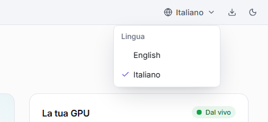

<p align="center"></p>

<h1 align="center">LLM Bench</h1>

<p align="center"><b>Il benchmark degli LLM in locale per le schede video NVIDIA, pensato per tutti.</b><br>
Misura quanto è veloce la tua GPU con i modelli linguistici di intelligenza artificiale (token al secondo, lunghezza del contesto, VRAM, consumi) con llama.cpp, vLLM, SGLang e NInfer, su Windows e Linux. I risultati te li spiega a parole.</p>

<p align="center"><a href="README.md">English</a> · Italiano · <a href="docs/GUIDA.md">Guida passo passo</a></p>

<picture>
  <source media="(prefers-color-scheme: dark)" srcset="docs/screenshots/it/benchmark-dark.png">
  
</picture>

Un **modello linguistico** (LLM) è il "cervello" di programmi come ChatGPT. Molti si possono scaricare e far girare sul proprio PC. **LLM Bench** è un programma che ti dice quanto bene ci riesce la tua scheda video NVIDIA: quanto velocemente il modello scrive e legge, quanto testo (contesto) entra nella memoria video e quali impostazioni vanno più veloci.

Non serve sapere nulla di tecnico: LLM Bench installa da solo quello che manca e ti chiede sempre conferma prima di scaricare qualcosa. Il programma parla **inglese** e **italiano**.

## Cosa fa

- **Misura la tua scheda video** con i modelli che scegli: tempo di caricamento, velocità di scrittura e di lettura in token al secondo, attesa della prima parola, più utenti insieme, memoria video (VRAM) di picco, consumi ed efficienza.
- **Ti spiega i numeri a parole**, per esempio: «Scrive circa 177 parole al secondo: molto più veloce di quanto tu riesca a leggere».
- **Trova le impostazioni migliori** da solo: cache KV, il contesto più grande che entra nella VRAM, dimensioni dei batch. Ti mostra la velocità di ogni combinazione al suo contesto massimo, con quel contesto pieno.
- **Confronta** test e modelli fianco a fianco, sempre alla stessa lunghezza di contesto.
- **Trova e scarica i modelli** da Hugging Face e ti dice prima se **entrano nella tua scheda**.
- **Tiene acceso un server locale compatibile con OpenAI** per i tuoi programmi (chat, editor di codice, assistenti), anche a finestra chiusa, dall'area di notifica.
- **Usa più motori** (i programmi che fanno girare i modelli): llama.cpp, vLLM, SGLang, NInfer e le loro versioni modificate. Li installa e li aggiorna con un pulsante.

## Cosa ti serve

- Una **scheda video NVIDIA** con il suo **driver**. Se il driver manca o è troppo vecchio, LLM Bench te lo dice e apre la pagina di NVIDIA per scaricarlo.
- **Windows 10 o 11** (64 bit) oppure **Linux** (Ubuntu, Debian e derivate; l'AppImage funziona anche su altre distribuzioni).
- Spazio su disco per i modelli: da pochi GB per i più piccoli a qualche decina per i più grandi.

Per il motore predefinito non serve altro: **llama.cpp** lo scarica e lo prepara LLM Bench al primo test.

Solo per alcuni motori:

- **Docker** per vLLM e SGLang (e per llama.cpp in un contenitore). Su Windows è Docker Desktop: se manca, LLM Bench lo installa e lo accende per te.
- **WSL 2** con una distribuzione Linux (per esempio Ubuntu 24.04) per usare NInfer su Windows.

## Installazione

> **Dove trovo i file di installazione?** Quando ci saranno le versioni pubblicate, le troverai nella pagina **Releases** di questo repository. Per ora si creano dal codice con `npm run dist` (vedi [Per sviluppatori](#per-sviluppatori)).

### Windows

1. Apri **`LLM-Bench-Setup-x.y.z.exe`** (x.y.z è il numero di versione).
2. Scegli la lingua, lascia la cartella proposta e premi **Installa**. Windows ti chiede una volta il permesso di amministratore: LLM Bench si installa in *Programmi*, per tutti gli utenti del PC.
3. Alla fine LLM Bench si apre da solo. Lo ritrovi sul desktop e nel menu Start.

> Se Windows mostra «Windows ha protetto il PC», clicca **Ulteriori informazioni** → **Esegui comunque**. Succede con i programmi nuovi, non ancora diffusi.

Preferisci non installare niente? Usa la versione **portable**, `LLM-Bench-x.y.z-portable.exe`: si apre con un doppio clic.

**Disinstallare.** Come ogni programma: Impostazioni di Windows → **App** → **App installate** → **LLM Bench** → **Disinstalla**. I tuoi risultati e le impostazioni restano in `%APPDATA%\LLM Bench`, i modelli nella cartella `LLM Bench\models` della tua cartella utente: cancellali tu se non ti servono più.

### Linux

- **Pacchetto .deb** (Ubuntu, Debian e derivate; consigliato): aprilo con il gestore dei pacchetti, oppure da terminale:

  ```bash
  sudo apt install ./llm-bench-x.y.z-amd64.deb
  ```

  LLM Bench compare tra le applicazioni. Per toglierlo: `sudo apt remove llm-bench`.
- **AppImage** (qualunque distribuzione): rendila eseguibile e aprila.

  ```bash
  chmod +x llm-bench-x.y.z-x86_64.AppImage
  ./llm-bench-x.y.z-x86_64.AppImage
  ```

> **Da GPU Bench a LLM Bench.** Fino alla versione 0.3 il programma si chiamava GPU Bench. Al primo avvio LLM Bench prende i tuoi risultati, le impostazioni e i motori; i modelli restano dove sono ([dettagli nella guida](docs/GUIDA.md#da-gpu-bench-a-llm-bench)).

## Il primo test in 3 passi

**1. Apri LLM Bench.** La prima volta controlla il PC (driver, scheda video, spazio libero) e ti propone da dove partire: il motore llama.cpp, un modello adatto alla tua scheda e un test *Rapido* di un paio di minuti. Se manca qualcosa, accanto c'è un pulsante che lo sistema. In alto scegli tra inglese e italiano.

<p align="center"><picture>
  <source media="(prefers-color-scheme: dark)" srcset="docs/screenshots/it/first-start-dark.png">
  
</picture></p>

**2. Premi «Avvia benchmark».** Se prima serve scaricare qualcosa, LLM Bench ti dice cosa e quanto pesa e aspetta il tuo sì. Durante il test vedi le fasi, la velocità dal vivo, la memoria video, la temperatura e i watt. Puoi annullare quando vuoi.

<picture>
  <source media="(prefers-color-scheme: dark)" srcset="docs/screenshots/it/test-running-dark.png">
  
</picture>

**3. Leggi il risultato.** In cima trovi il punteggio e una frase che lo spiega; sotto, ogni numero con il suo significato (il **?** accanto a ogni voce lo spiega). I riquadri colorati ti dicono se qualcosa può aver falsato la misura e come rimediare.

<picture>
  <source media="(prefers-color-scheme: dark)" srcset="docs/screenshots/it/result-dark.png">
  
</picture>

Quanto dura un test lo scegli tu:

| Test | Quanto ci vuole | Cosa misura |
|---|---|---|
| **Rapido** | circa 2 minuti | Un caricamento e un testo di prova: per farti un'idea |
| **Standard** | circa 6 minuti | Caricamento a freddo e a caldo, testi corti e lunghi, più utenti insieme. Sul modello di riferimento dà il Punteggio LLM Bench |
| **Completo** | 15–30 minuti | Tutto, ripetuto più volte, per la massima precisione |
| **Trova le impostazioni migliori** | te lo dice prima | Vedi [più sotto](#trovare-le-impostazioni-migliori) |

## Trovare le impostazioni migliori

Scegli **Trova le impostazioni migliori**, poi *Veloce* o *Accurata*: accanto a ognuna LLM Bench ti dice quanto ci vorrà **per quel modello sulla tua scheda** (da pochi minuti a più di mezz'ora per i modelli grandi). La stima tiene conto anche dei dischi lenti: un modello letto da una cartella di Windows attraverso WSL o Docker Desktop si carica più piano.

Poi LLM Bench avvia il modello più volte e prova da solo:

- la **cache KV**, la memoria dove il modello tiene il testo già letto: f16, poi le compresse q8_0 e q4_0, che lasciano spazio a molto più testo;
- il **contesto più grande** che entra tutto nella memoria video, per ogni tipo di cache;
- le impostazioni che cambiano la velocità: flash attention, batch e micro-batch e, se hai un file draft o MTP per il modello, la generazione speculativa.

<picture>
  <source media="(prefers-color-scheme: dark)" srcset="docs/screenshots/it/tune-result-dark.png">
  
</picture>

**Ogni velocità è letta al contesto massimo, con quel contesto pieno**, perché è così che va il modello quando usi tutto il contesto che hai impostato. La **combinazione consigliata** è la più veloce tra quelle che arrivano al contesto più grande. La **classifica** mette ogni combinazione al suo contesto massimo (prima il contesto più grande, poi la più veloce); scegli una profondità in **Confronta a** (1K, 64K…) per confrontarle tutte con il contesto riempito fino lì. Ogni prova ha il suo comando esatto.

<picture>
  <source media="(prefers-color-scheme: dark)" srcset="docs/screenshots/it/tune-ranking-dark.png">
  
</picture>

**Usa questo preset** porta la combinazione consigliata in un benchmark o in un server. Se il tempo della ricerca finisce, il risultato tiene quello che ha misurato e ti dice perché (per esempio, ogni avvio del motore ha richiesto più del previsto).

## Risultati e confronti

| Numero | Cosa vuol dire |
|---|---|
| **Generazione** (tok/s) | Quanto velocemente il modello **scrive**. Un *token* è un pezzo di parola: 100 token sono circa 70 parole |
| **Lettura prompt** (tok/s) | Quanto velocemente **legge** il testo che gli dai: la domanda, un documento, il codice. Conta molto con i testi lunghi |
| **Primo token** (ms) | Quanto aspetti prima che compaia la prima parola. Sotto i 200 ms sembra istantaneo |
| **Caricamento a freddo / a caldo** | Quanto ci mette ad aprire il modello: dal disco la prima volta, oppure quando il PC lo tiene già in memoria |
| **VRAM di picco** | Quanta memoria della scheda video ha usato al massimo |
| **Più utenti** | Quanto scrive in tutto, e per ciascuno, quando più persone lo usano insieme |
| **Efficienza** (tok/J) | Quanto lavoro fa per ogni unità di energia: più è alto, meno consuma |
| **Punteggio LLM Bench** | Un numero solo per confrontare le schede: 1.000 è una RTX 5090 con llama.cpp sul modello di riferimento. Si calcola solo con il test Standard su quel modello |

**Ogni velocità dice con quanto testo è stata misurata.** Un modello rallenta quando ha già molto testo davanti (il *contesto*): per questo LLM Bench non scrive mai un numero da solo. Trovi sempre «scrittura con 32.768 token già nel contesto» oppure «lettura di un prompt da 512 token». Due velocità si confrontano solo alla stessa lunghezza, e il Confronta lo fa per te.

<picture>
  <source media="(prefers-color-scheme: dark)" srcset="docs/screenshots/it/results-dark.png">
  
</picture>

Nella pagina **Risultati** ritrovi tutti i test, con filtri per modello, scheda e motore. La vista **Configurazioni** li raggruppa per modo di avvio, dal più veloce; una ricerca di "Trova le impostazioni migliori" compare lì al suo contesto massimo, come ovunque. Ogni risultato si esporta in CSV, JSON, Markdown o HTML, e con **Usa questo preset** riparti con le stesse impostazioni.

Premi **Confronta** accanto a un test, oppure **Confronta modelli** nella pagina Risultati e scegline da 2 a 4: per ogni modello LLM Bench prende la configurazione più veloce misurata sulla tua scheda. In cima una frase ti dice chi scrive e chi legge più in fretta, e di quanto; sotto, ogni misura ha il migliore evidenziato e gli altri detti a parole («2,2 volte più lento», «−16 %»). Dove un test non ha misurato una lunghezza c'è scritto «non misurato», mai una stima. L'indirizzo della pagina contiene il confronto, quindi puoi riaprirlo o condividerlo.

<picture>
  <source media="(prefers-color-scheme: dark)" srcset="docs/screenshots/it/compare-dark.png">
  
</picture>

## Modelli che entrano nella tua scheda

Nella pagina **Modelli** trovi quelli che hai già sul PC (anche quelli di LM Studio, Ollama e Hugging Face), i consigliati per la tua scheda e la ricerca su Hugging Face, con il filtro **Entra nella mia GPU**. Ogni modello ha più **versioni** (quantizzazioni): LLM Bench sceglie da solo la migliore che entra (**Consigliata**) e accanto a ognuna ti dice se ci sta, da **Entra perfettamente** a **Non entra**.

<p align="center"><picture>
  <source media="(prefers-color-scheme: dark)" srcset="docs/screenshots/it/model-versions-dark.png">
  
</picture></p>

Il download si mette in pausa e riprende da solo se la connessione cade, e quello che hai già non si riscarica mai. Se un modello cambia su Hugging Face, **Aggiorna** scarica solo i file cambiati.

## Tenere acceso un server locale

Vuoi usare un modello nei tuoi programmi, senza test? Apri **Server** e premi **Avvia un server**: scegli il modello, il motore e le impostazioni (le migliori dei tuoi test, un preset o le tue). LLM Bench ti mostra cosa avvierà prima di farlo. Ogni server acceso ha l'**indirizzo compatibile con OpenAI** e il **nome del modello** da copiare, con esempi pronti per il terminale, per Python e per programmi come Open WebUI, Continue o Chatbox.

<picture>
  <source media="(prefers-color-scheme: dark)" srcset="docs/screenshots/it/server-dark.png">
  
</picture>

**Dall'area di notifica.** Se chiudi la finestra con un server acceso, LLM Bench resta vicino all'orologio e il server continua a funzionare. Dal menu copi l'indirizzo, fermi o riavvii un server, avvii un **preset** o esci.

<p align="center"><picture>
  <source media="(prefers-color-scheme: dark)" srcset="docs/screenshots/it/tray-menu-dark.png">
  
</picture></p>

**Salva come preset** ricorda modello, motore, impostazioni e porta, per riavviarlo con un clic; segnalo **Avvia all'apertura di LLM Bench** per farlo partire da solo. Un server risponde solo al tuo PC, a meno che tu non attivi **Rendi raggiungibile dalla rete locale**, che lo protegge con una chiave generata da LLM Bench.

## Motori

I motori sono i programmi che fanno girare i modelli. Ne basta uno: se non sai quale scegliere, lascia **llama.cpp**.

| Motore | A cosa serve | Cosa ti serve |
|---|---|---|
| **llama.cpp** | Il più semplice: legge i modelli GGUF, il formato più diffuso | Niente: LLM Bench lo scarica da solo (anche in Docker, se vuoi) |
| **vLLM** | Pensato per servire molti utenti insieme | Docker; su Linux anche installato sul PC |
| **SGLang** | Veloce con molti utenti e con testi che si ripetono | Docker; su Linux anche installato sul PC |
| **NInfer** e **NInfer-all** | Fatti apposta per alcuni modelli Qwen su una sola **RTX 5090**; NInfer-all legge anche i modelli GGUF-NInfer | Una RTX 5090; su Windows WSL 2. LLM Bench lo scarica e lo compila per te |
| **Motori personalizzati** | Una versione modificata (fork) di llama.cpp, vLLM, SGLang o NInfer, o un tuo programma con API compatibile con OpenAI | Dove si trova: LLM Bench lo prova prima di usarlo |

Ogni motore ha la sua scheda nella pagina **Motori**, con lo stato, le versioni e i pulsanti per installare, scegliere la versione e **Aggiorna**. Prima di aggiornare LLM Bench ti mostra i comandi esatti che eseguirà; la versione di prima resta sul PC finché la nuova non funziona.

<picture>
  <source media="(prefers-color-scheme: dark)" srcset="docs/screenshots/it/engines-dark.png">
  
</picture>

## Lingua

LLM Bench parte in **inglese**. Passi all'**italiano** dal globo nella barra del titolo, in cima alla schermata di benvenuto o in **Impostazioni**: ogni pagina, il menu dell'area di notifica e le finestre di avvio seguono la scelta.

<p align="center"><picture>
  <source media="(prefers-color-scheme: dark)" srcset="docs/screenshots/it/language-menu-dark.png">
  
</picture></p>

## Se qualcosa non va

Ogni problema che LLM Bench riconosce ha una spiegazione e, quasi sempre, un pulsante che lo risolve. I casi più comuni:

### «Docker non risponde»

Di solito il **Resource Saver** di Docker Desktop lo ha spento dopo qualche minuto senza contenitori e lo spegnimento si è bloccato a metà. Premi **Riavvia Docker**, dall'avviso in cima alla finestra o dal menu dell'area di notifica: immagini e modelli restano, e i server di LLM Bench ripartono da soli. Per evitarlo, in Docker Desktop apri Impostazioni → **Resources** → **Advanced** e disattiva **Resource Saver**.

### «Docker non è avviato»

Premi **Avvia Docker**: LLM Bench lo accende e continua da solo.

### «La memoria della scheda video è occupata»

Un gioco, un altro modello o una macchina virtuale stanno usando la scheda. Chiudili, oppure premi **Continua comunque** (il risultato lo segnerà). Anche un server acceso occupa la scheda: LLM Bench ti propone di fermarlo prima del test.

### Il modello non entra nella memoria video (test lento)

Su Windows la parte che non entra finisce nella RAM del PC e tutto va 10–15 volte più piano. LLM Bench te lo dice prima del test, durante e nel risultato. Usa una versione più compressa del modello, la cache **q4_0** (la memoria del testo occupa circa un quarto), meno contesto, oppure **Trova le impostazioni migliori**.

### «Driver NVIDIA non installato» o «Driver NVIDIA troppo vecchio»

Premi il pulsante che apre la pagina di NVIDIA, installa il driver e poi premi **Ricontrolla**.

### NInfer-all non si compila sulla RTX 5090

Serve il toolkit **CUDA 13.1 o più recente**, dal sito di NVIDIA (su Windows dentro la distribuzione WSL): quello dei pacchetti di Ubuntu è troppo vecchio per questa scheda. LLM Bench lo controlla prima di compilare e ti dice cosa manca.

Altri casi e tutti i dettagli sono nella [guida](docs/GUIDA.md#problemi-comuni).

## Guida

Sei alle prime armi? La **[guida passo passo](docs/GUIDA.md)** ti accompagna in ogni schermata: installazione, primo test, impostazioni migliori, confronti, modelli, server e motori. In inglese: [Guide](docs/GUIDE.md).

## Per sviluppatori

Serve **Node.js 22** o più recente.

```bash
npm install
npm run build        # main, preload e core (esbuild) + interfaccia (Vite)
npm start            # apre l'app Electron
npm run validate     # lint, tipi, confini architetturali, test unitari e di integrazione, E2E, copertura 100%
npm run ci:docker    # la stessa validazione in un contenitore Linux pulito, sul commit attuale
npm run dist         # installer Windows (NSIS + portable) o pacchetti Linux (.deb + AppImage)
```

- **CI.** Non c'è una CI su GitHub, per scelta: la CI è locale. `npm run ci:docker` valida il commit attuale (`git HEAD`) in Linux, dentro Docker, con gli E2E sotto Xvfb (`-- --fast` li salta).
- **Pacchetti Linux da Windows.** `node scripts/dist-linux.mjs` costruisce il .deb e l'AppImage nell'immagine Docker di electron-builder.
- **Screenshot.** `node scripts/mockups.mjs` fotografa le schermate principali in `.qa/mockups` (chiaro e scuro) con dati realistici e servizi finti, senza toccare GPU, impostazioni o modelli veri. `node scripts/mockups.mjs --only=readme` rigenera le immagini dei README e delle guide in `docs/screenshots/en` e `docs/screenshots/it`.

**Architettura**

- `src/main`: il guscio Electron (finestra, area di notifica, dialoghi, segreti cifrati).
- `src/core`: un server HTTP locale (127.0.0.1, con un token per sessione) in un utility process: motori, modelli, download, benchmark, telemetria della GPU, Docker, server.
- `src/renderer`: l'interfaccia React (design system proprio, inglese e italiano).
- `src/contract`: gli schemi condivisi (zod) e i tipi delle risposte.

**Test**

- `test/unit`, `test/integration`: Vitest, con servizi finti deterministici in `test/fakes` (motore LLM, nvidia-smi, Docker, WSL, GitHub, Hugging Face).
- `test/e2e`: Playwright sulla vera app Electron, scritti come li userebbe una persona (ruoli ed etichette visibili), con il controllo di accessibilità axe.
- `scripts/coverage.mjs` unisce la copertura di unit ed E2E: il limite è il 100 % su ogni file.

Le idee per la stima della memoria video vengono in parte da [llmfit](https://github.com/AlexsJones/llmfit) (licenza MIT).
