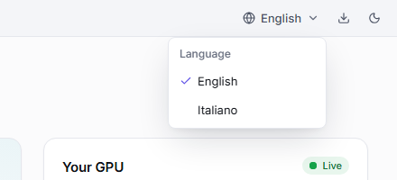

<p align="center"></p>

<h1 align="center">LLM Bench</h1>

<p align="center"><b>A local LLM benchmark for NVIDIA graphics cards, made for everyone.</b><br>
Measure how fast your GPU runs AI language models (tokens per second, context length, VRAM, power) with llama.cpp, vLLM, SGLang and NInfer, on Windows and Linux. Results in plain words.</p>

<p align="center">English · <a href="README.it.md">Italiano</a> · <a href="docs/GUIDE.md">Step-by-step guide</a></p>

<picture>
  <source media="(prefers-color-scheme: dark)" srcset="docs/screenshots/en/benchmark-dark.png">
  
</picture>

A **large language model** (LLM) is the "brain" behind programs like ChatGPT. Many of them can be downloaded and run on your own PC. **LLM Bench** is a desktop app that tells you how well your NVIDIA graphics card runs them: how fast the model writes and reads, how much text (context) fits in video memory, and which settings are the fastest.

You don't need to know anything technical. LLM Bench sets up what is missing by itself and always asks before downloading anything. The app speaks **English** and **Italian**.

## What it does

- **Benchmarks your graphics card** with the models you choose: load time, generation speed and prompt reading speed in tokens per second, time to the first word, several users at once, peak video memory (VRAM), power and efficiency.
- **Explains the numbers in words**, for example "It writes about 177 words per second: much faster than you can read".
- **Finds the best settings** by itself: KV cache, the largest context that fits in VRAM, batch sizes. It shows the speed of each combination at its largest context, with that context full.
- **Compares** tests and models side by side, always at the same context length.
- **Finds and downloads models** from Hugging Face and tells you up front whether they **fit your card**.
- **Runs a local OpenAI-compatible server** for your own apps (chat, code editors, assistants), even with the window closed, from the notification area.
- **Works with several engines** (the programs that run the models): llama.cpp, vLLM, SGLang, NInfer and their forks. It installs and updates them with one button.

## Requirements

- An **NVIDIA graphics card** with its **driver**. If the driver is missing or too old, LLM Bench tells you and opens NVIDIA's download page.
- **Windows 10 or 11** (64-bit) or **Linux** (Ubuntu, Debian and derivatives; the AppImage also runs on other distributions).
- Disk space for the models: a few GB for small ones, tens of GB for large ones.

That is all for the default engine: LLM Bench downloads and sets up **llama.cpp** at the first test.

Only for some engines:

- **Docker** for vLLM and SGLang (and for llama.cpp in a container). On Windows this is Docker Desktop: if it is missing, LLM Bench installs it and starts it for you.
- **WSL 2** with a Linux distribution (for example Ubuntu 24.04) to use NInfer on Windows.

## Install

> **Where are the installers?** Once versions are published, they will be on this repository's **Releases** page. Until then, build them from the source with `npm run dist` (see [Developers](#developers)).

### Windows

1. Open **`LLM-Bench-Setup-x.y.z.exe`** (x.y.z is the version number).
2. Pick the language, keep the proposed folder and press **Install**. Windows asks once for administrator permission: LLM Bench installs into *Program Files*, for every user of the PC.
3. LLM Bench opens by itself at the end. You will find it on the desktop and in the Start menu.

> If Windows shows "Windows protected your PC", click **More info** → **Run anyway**. This happens with new programs that are not widely known yet.

Prefer not to install anything? Use the **portable** version, `LLM-Bench-x.y.z-portable.exe`: double-click it to run.

**Uninstall** like any program: Windows Settings → **Apps** → **Installed apps** → **LLM Bench** → **Uninstall**. Your results and settings stay in `%APPDATA%\LLM Bench` and your models in the `LLM Bench\models` folder of your user folder: delete them yourself if you no longer need them.

### Linux

- **.deb package** (Ubuntu, Debian and derivatives; recommended): open it with your package manager, or from a terminal:

  ```bash
  sudo apt install ./llm-bench-x.y.z-amd64.deb
  ```

  LLM Bench appears among your applications. To remove it: `sudo apt remove llm-bench`.
- **AppImage** (any distribution): make it executable and open it.

  ```bash
  chmod +x llm-bench-x.y.z-x86_64.AppImage
  ./llm-bench-x.y.z-x86_64.AppImage
  ```

> **From GPU Bench to LLM Bench.** Up to version 0.3 the app was called GPU Bench. At its first start LLM Bench takes over your results, settings and engines; models stay where they are ([details in the guide](docs/GUIDE.md#from-gpu-bench-to-llm-bench)).

## Quick start: your first benchmark in 3 steps

**1. Open LLM Bench.** The first time, it checks your PC (driver, graphics card, free space) and suggests where to start: the llama.cpp engine, a model that fits your card and a *Quick* test of a couple of minutes. Anything missing has a button next to it that fixes it. You can switch between English and Italian at the top.

<p align="center"><picture>
  <source media="(prefers-color-scheme: dark)" srcset="docs/screenshots/en/first-start-dark.png">
  
</picture></p>

**2. Press "Start benchmark".** If something must be downloaded first, LLM Bench tells you what and how big, and waits for your OK. During the test you see each phase, the live speed, video memory, temperature and watts. You can cancel at any time.

<picture>
  <source media="(prefers-color-scheme: dark)" srcset="docs/screenshots/en/test-running-dark.png">
  
</picture>

**3. Read the result.** At the top, the score and a sentence that explains it; below, every number with its meaning (the **?** next to each one explains it). Coloured boxes tell you when something may have skewed the measurement, and how to fix it.

<picture>
  <source media="(prefers-color-scheme: dark)" srcset="docs/screenshots/en/result-dark.png">
  
</picture>

You choose how long a test lasts:

| Test | How long | What it measures |
|---|---|---|
| **Quick** | about 2 minutes | One load and one test prompt: to get an idea |
| **Standard** | about 6 minutes | Cold and warm load, short and long prompts, several users at once. On the reference model it gives the LLM Bench score |
| **Full** | 15–30 minutes | Everything, repeated more times, for the best precision |
| **Find the best settings** | told before it starts | See [below](#find-the-best-settings) |

## Find the best settings

Choose **Find the best settings**, then *Fast* or *Thorough*: next to each, LLM Bench tells you how long it will take **for that model on your card** (from a few minutes to over half an hour for large models). The estimate counts slow disks too: a model read from a Windows folder through WSL or Docker Desktop loads more slowly.

Then LLM Bench starts the model several times and tries by itself:

- the **KV cache**, the memory where the model keeps the text it has read: f16, then the compressed q8_0 and q4_0, which leave room for much more text;
- the **largest context** that fits entirely in video memory, for each cache type;
- the settings that change the speed: flash attention, batch and micro-batch and, if you have a draft or MTP file for the model, speculative decoding.

<picture>
  <source media="(prefers-color-scheme: dark)" srcset="docs/screenshots/en/tune-result-dark.png">
  
</picture>

**Every speed is read at the largest context, with that context full**, because that is how the model runs when you use all the context you set. The **recommended combination** is the fastest among those that reach the largest context. The **ranking** lists every combination at its own largest context (largest context first, then the fastest); pick a depth in **Compare at** (1K, 64K…) to compare them all with the context filled up to there. Every attempt has its exact command.

<picture>
  <source media="(prefers-color-scheme: dark)" srcset="docs/screenshots/en/tune-ranking-dark.png">
  
</picture>

**Use this preset** takes the recommended combination to a benchmark or a server. If the search runs out of time, the result keeps what it measured and says why (for example, each engine start took longer than expected).

## Results and comparing

| Number | What it means |
|---|---|
| **Generation** (tok/s) | How fast the model **writes**. A *token* is a piece of a word: 100 tokens are about 75 words |
| **Prompt reading** (tok/s) | How fast it **reads** what you give it: the question, a document, code. It matters a lot with long texts |
| **First token** (ms) | How long you wait for the first word. Under 200 ms it feels instant |
| **Cold / warm load** | How long it takes to open the model: from disk the first time, or when the PC already holds it in memory |
| **Peak VRAM** | The most video memory it used |
| **Several users** | How much it writes in total, and for each person, when several people use it at once |
| **Efficiency** (tok/J) | Work per unit of energy: higher means it uses less power |
| **LLM Bench score** | One number to compare graphics cards: 1,000 is an RTX 5090 with llama.cpp on the reference model. Only a Standard test of that model gets one |

**Every speed says how much text it was measured with.** A model slows down when it already has a lot of text in front of it (the *context*), so LLM Bench never shows a bare number: you always read "writing with 32,768 tokens already in context" or "reading a 512-token prompt". Two speeds only compare at the same length, and Compare does that for you.

<picture>
  <source media="(prefers-color-scheme: dark)" srcset="docs/screenshots/en/results-dark.png">
  
</picture>

The **Results** page lists every test, with filters for model, graphics card and engine. The **Configurations** view groups them by how the model was started, fastest first; a "Find the best settings" search shows there at its largest context, like everywhere else. Export any result to CSV, JSON, Markdown or HTML, and press **Use this preset** to start again with the same settings.

Press **Compare** next to a test, or **Compare models** on the Results page and pick 2 to 4: for each model LLM Bench takes the fastest configuration measured on your card. A sentence on top says who writes and who reads faster, and by how much; below, each measurement highlights the best and puts the others in words ("2.2 times slower", "−16%"). Where a test did not measure a length, it says "not measured", never an estimate. The page address holds the comparison, so you can reopen or share it.

<picture>
  <source media="(prefers-color-scheme: dark)" srcset="docs/screenshots/en/compare-dark.png">
  
</picture>

## Models that fit your card

The **Models** page lists the models already on your PC (LM Studio, Ollama and Hugging Face folders included), the ones recommended for your card and the Hugging Face search, with the **Fits my GPU** filter. Each model comes in several **versions** (quantizations): LLM Bench picks the best one that fits (**Recommended**) and labels each one, from **Fits perfectly** to **Does not fit**.

<p align="center"><picture>
  <source media="(prefers-color-scheme: dark)" srcset="docs/screenshots/en/model-versions-dark.png">
  
</picture></p>

Downloads pause and resume by themselves if the connection drops, and what you already have is never downloaded again. When a model changes on Hugging Face, **Update** downloads only the files that changed.

## Run a local server

Want to use a model in your own apps, without a test? Open **Servers** and press **Start a server**: choose the model, the engine and the settings (the best from your tests, a preset or your own). LLM Bench shows what it will start before it does. Each running server shows its **OpenAI-compatible address** and **model name** to copy, with ready examples for the terminal, Python and apps like Open WebUI, Continue or Chatbox.

<picture>
  <source media="(prefers-color-scheme: dark)" srcset="docs/screenshots/en/server-dark.png">
  
</picture>

**From the notification area.** Close the window with a server running and LLM Bench stays next to the clock: the server keeps working. From the menu you copy the address, stop or restart a server, start a **preset** or quit.

<p align="center"><picture>
  <source media="(prefers-color-scheme: dark)" srcset="docs/screenshots/en/tray-menu-dark.png">
  
</picture></p>

**Save as preset** remembers model, engine, settings and port, to start it again with one click; mark it **Start when LLM Bench opens** to start it by itself. A server answers only your PC unless you turn on **Make it reachable from the local network**, which protects it with a key LLM Bench creates for you.

## Engines

Engines are the programs that run the models. One is enough: if you are not sure, keep **llama.cpp**.

| Engine | What it is for | What you need |
|---|---|---|
| **llama.cpp** | The simplest: reads GGUF models, the most common format | Nothing: LLM Bench downloads it (in Docker too, if you like) |
| **vLLM** | Built to serve many users at once | Docker; on Linux it can also be installed on the PC |
| **SGLang** | Fast with many users and with repeated text | Docker; on Linux it can also be installed on the PC |
| **NInfer** and **NInfer-all** | Made for some Qwen models on a single **RTX 5090**; NInfer-all also reads GGUF-NInfer models | An RTX 5090; WSL 2 on Windows. LLM Bench downloads and builds it |
| **Custom engines** | A fork of llama.cpp, vLLM, SGLang or NInfer, or your own program with an OpenAI-compatible API | Where it is: LLM Bench tries it before using it |

Each engine has a card on the **Engines** page with its state, its versions and the buttons to install, choose a version and **Update**. Before updating, LLM Bench shows the exact commands it will run, and the previous version stays on the PC until the new one works.

<picture>
  <source media="(prefers-color-scheme: dark)" srcset="docs/screenshots/en/engines-dark.png">
  
</picture>

## Language

LLM Bench starts in **English**. Switch to **Italiano** from the globe in the title bar, at the top of the welcome screen or in **Settings**: every page, the notification-area menu and the start-up dialogs follow.

<p align="center"><picture>
  <source media="(prefers-color-scheme: dark)" srcset="docs/screenshots/en/language-menu-dark.png">
  
</picture></p>

## Troubleshooting

Every problem LLM Bench recognises comes with an explanation and, almost always, a button that fixes it. The most common ones:

### "Docker is not responding"

Usually Docker Desktop's **Resource Saver** stopped it after a few minutes without containers, and the stop got stuck halfway. Press **Restart Docker**, from the banner at the top of the window or from the notification-area menu: images and models stay, and LLM Bench's servers start again by themselves. To avoid it, open Docker Desktop's Settings → **Resources** → **Advanced** and turn off **Resource Saver**.

### "Docker is not running"

Press **Start Docker**: LLM Bench starts it and carries on.

### "The graphics memory is in use"

A game, another model or a virtual machine is using the card. Close them, or press **Continue anyway** (the result will say so). A running server also takes the card: LLM Bench offers to stop it before the test.

### The model does not fit in video memory (slow test)

On Windows the part that does not fit goes to the PC's RAM and everything becomes 10–15 times slower. LLM Bench warns you before the test, during it and in the result. Use a more compressed version of the model, the **q4_0** cache (the text memory takes about a quarter), less context, or **Find the best settings**.

### "NVIDIA driver not installed" or "NVIDIA driver too old"

Press the button that opens NVIDIA's page, install the driver, then press **Check again**.

### NInfer-all does not build on the RTX 5090

It needs the **CUDA 13.1 or newer** toolkit from NVIDIA's site (inside the WSL distribution on Windows): Ubuntu's own package is too old for this card. LLM Bench checks it before building and tells you what is missing.

More cases and details are in the [guide](docs/GUIDE.md#troubleshooting).

## Guide

New to all this? The **[step-by-step guide](docs/GUIDE.md)** walks you through every screen: installing, the first test, finding the best settings, comparing, models, servers and engines. Also in Italian: [Guida](docs/GUIDA.md).

## Developers

You need **Node.js 22** or newer.

```bash
npm install
npm run build        # main, preload and core (esbuild) + UI (Vite)
npm start            # opens the Electron app
npm run validate     # lint, types, architecture boundaries, unit and integration tests, E2E, 100% coverage
npm run ci:docker    # the same validation in a clean Linux container, on the current commit
npm run dist         # Windows installers (NSIS + portable) or Linux packages (.deb + AppImage)
```

- **CI.** There is no GitHub CI, on purpose: the CI is local. `npm run ci:docker` validates the current commit (`git HEAD`) on Linux, inside Docker, with the E2E tests under Xvfb (`-- --fast` skips them).
- **Linux packages from Windows.** `node scripts/dist-linux.mjs` builds the .deb and the AppImage in electron-builder's Docker image.
- **Screenshots.** `node scripts/mockups.mjs` renders the main screens into `.qa/mockups` (light and dark) with realistic data and fake services, without touching the real GPU, settings or models. `node scripts/mockups.mjs --only=readme` regenerates the images of the READMEs and the guides in `docs/screenshots/en` and `docs/screenshots/it`.

**Architecture**

- `src/main`: the Electron shell (window, notification area, dialogs, encrypted secrets).
- `src/core`: a local HTTP server (127.0.0.1, with a per-session token) in a utility process: engines, models, downloads, benchmarks, GPU telemetry, Docker, servers.
- `src/renderer`: the React UI (its own design system, English and Italian).
- `src/contract`: the shared schemas (zod) and response types.

**Tests**

- `test/unit`, `test/integration`: Vitest, with deterministic fake services in `test/fakes` (LLM engine, nvidia-smi, Docker, WSL, GitHub, Hugging Face).
- `test/e2e`: Playwright on the real Electron app, written the way a person would use it (visible roles and labels), with axe accessibility checks.
- `scripts/coverage.mjs` merges unit and E2E coverage: the bar is 100% on every file.

The video memory estimate is partly inspired by [llmfit](https://github.com/AlexsJones/llmfit) (MIT license).
