# Guida di LLM Bench

[English](GUIDE.md) · Italiano · [Torna al README](../README.it.md)

LLM Bench misura quanto è veloce la tua scheda video NVIDIA con i modelli linguistici di intelligenza artificiale (LLM), sul tuo PC. Scarica e avvia i modelli, li fa lavorare con testi di prova e ti dice, in parole semplici, quanto vanno veloci e quali impostazioni sono le migliori per la tua scheda.

Non serve sapere nulla di tecnico: LLM Bench installa da solo quello che manca e ti chiede conferma prima di scaricare qualunque cosa. Questa guida segue il programma una schermata alla volta.

**Indice:** [Cosa ti serve](#cosa-ti-serve) · [Installazione](#installazione) · [Primo avvio](#primo-avvio) · [Fare un benchmark](#fare-un-benchmark) · [Leggere un risultato](#leggere-un-risultato) · [Trovare le impostazioni migliori](#trovare-le-impostazioni-migliori) · [Risultati e Confronta](#risultati-e-confronta) · [Modelli](#modelli) · [Server e area di notifica](#server-e-area-di-notifica) · [Motori](#motori) · [Impostazioni utili](#impostazioni-utili) · [Problemi comuni](#problemi-comuni)

## Cosa ti serve

- Una **scheda video NVIDIA** con il suo **driver**. Se il driver manca o è troppo vecchio, LLM Bench te lo dice e apre la pagina di NVIDIA per scaricarlo.
- **Windows 10 o 11** (64 bit) oppure **Linux** (Ubuntu, Debian e derivate; l'AppImage funziona anche su altre distribuzioni).
- Spazio su disco per i modelli: da pochi GB per i più piccoli a qualche decina per i più grandi.

Per il motore predefinito non serve altro: **llama.cpp** lo scarica e lo prepara LLM Bench al primo test.

Solo per alcuni motori:

- **Docker** per vLLM e SGLang (e per llama.cpp in un contenitore). Su Windows è Docker Desktop: se manca, LLM Bench lo installa e lo accende per te.
- **WSL 2** con una distribuzione Linux (per esempio Ubuntu 24.04) per usare NInfer su Windows.

## Installazione

Scarica il file per il tuo sistema dall'**[ultima versione](https://github.com/nemmusu/llm-bench/releases/latest)**.

### Windows

1. Apri **`LLM-Bench-Setup-x.y.z.exe`** (x.y.z è il numero di versione).
2. Scegli la lingua, lascia la cartella proposta e premi **Installa**. Windows ti chiede una volta il permesso di amministratore: LLM Bench si installa in *Programmi*, per tutti gli utenti del PC.
3. Alla fine LLM Bench si apre da solo. Lo ritrovi sul desktop e nel menu Start.

> Se Windows mostra «Windows ha protetto il PC», clicca **Ulteriori informazioni** → **Esegui comunque**. Succede con i programmi nuovi, non ancora diffusi.

Preferisci non installare niente? Usa la versione **portable**, `LLM-Bench-x.y.z-portable.exe`: si apre con un doppio clic.

**Disinstallare.** Come ogni programma: Impostazioni di Windows → **App** → **App installate** → **LLM Bench** → **Disinstalla**. I tuoi risultati e le impostazioni restano in `%APPDATA%\LLM Bench`, i modelli nella cartella `LLM Bench\models` della tua cartella utente: cancellali tu se non ti servono più.

### Linux

- **Pacchetto .deb** (Ubuntu, Debian e derivate; consigliato): aprilo con il gestore dei pacchetti, oppure da terminale:

  ```bash
  sudo apt install ./llm-bench-x.y.z-amd64.deb
  ```

  LLM Bench compare tra le applicazioni. Per toglierlo: `sudo apt remove llm-bench`.
- **AppImage** (qualunque distribuzione): rendila eseguibile e aprila.

  ```bash
  chmod +x llm-bench-x.y.z-x86_64.AppImage
  ./llm-bench-x.y.z-x86_64.AppImage
  ```

### Aggiornare LLM Bench

LLM Bench non si aggiorna da solo: scarica la nuova versione dall'**[ultima versione](https://github.com/nemmusu/llm-bench/releases/latest)** (la apre **Impostazioni → Informazioni → Pagina delle release**) e installala sopra questa, oppure sostituisci il file portatile o l'AppImage. Risultati, impostazioni e modelli restano.

### Da GPU Bench a LLM Bench

Fino alla versione 0.3 il programma si chiamava **GPU Bench**. Al primo avvio LLM Bench prende i tuoi dati e te lo dice una volta:

- risultati, impostazioni, preset, motori installati e token di Hugging Face passano nella cartella di LLM Bench (su Windows `%APPDATA%\LLM Bench`, su Linux `~/.config/LLM Bench`). Se GPU Bench è ancora aperto, LLM Bench ne copia i dati e lascia la sua cartella com'era;
- i **modelli restano dove sono**: se usavi la cartella predefinita (`GPU Bench\models` nella tua cartella utente), LLM Bench continua a usare quella;
- se GPU Bench partiva all'accesso, ora parte LLM Bench al suo posto;
- su Linux, se il token di Hugging Face non si può più leggere (il portachiavi del sistema lo lega al nome del programma), LLM Bench lo toglie e ti chiede di reinserirlo.

I test fatti prima dicono ancora "GPU Bench 0.3": è la loro storia. GPU Bench puoi disinstallarlo quando vuoi.

## Primo avvio

La schermata **Benvenuto** controlla il PC e mostra una lista a semafori:

| Voce | Cosa significa |
|---|---|
| Driver NVIDIA | La versione del driver e la versione CUDA che supporta |
| Scheda video | Il modello della scheda e quanta memoria video (VRAM) ha |
| Motore llama.cpp | Il programma che fa girare i modelli. Se manca, un pulsante lo installa (circa 500 MB) |
| Modelli | I modelli già presenti sul PC (anche quelli di LM Studio, Ollama e Hugging Face) |
| Spazio su disco | Lo spazio libero nella cartella dei modelli |
| Docker | Facoltativo: serve solo per vLLM e SGLang (e per llama.cpp in un contenitore) |

Ogni voce in rosso o arancione ha **un solo pulsante** che la sistema. Poi LLM Bench ti propone una configurazione per la tua scheda: il motore llama.cpp, un modello che entra e un test *Rapido*.

LLM Bench parte in inglese: il selettore **English / Italiano** in cima alla schermata di benvenuto cambia lingua subito. Più avanti ritrovi la stessa scelta nel globo della barra del titolo e in **Impostazioni**.

<p align="center"><picture>
  <source media="(prefers-color-scheme: dark)" srcset="screenshots/it/first-start-dark.png">
  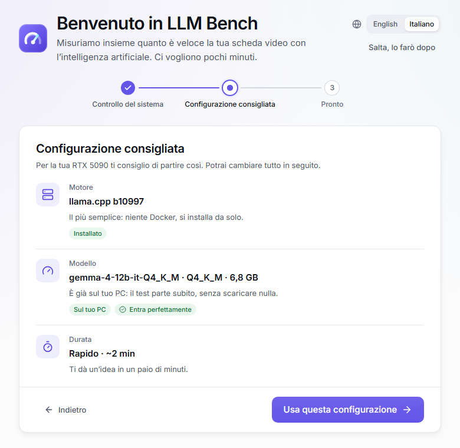
</picture></p>

## Fare un benchmark

Nella pagina **Benchmark** scegli tre cose:

1. **Motore**: lascia *llama.cpp* (consigliato) se non sai cosa scegliere.
2. **Modello**: i modelli consigliati per la tua scheda hanno un'etichetta colorata: **Entra perfettamente** o **Entra bene** (nessun problema), **Al limite** (chiudi prima gli altri programmi), **Entra in parte** (funziona, ma più lentamente), **Non entra** (troppo grande per la tua scheda). **Provato su questa GPU** vuol dire che l'hai già misurato, con la sua velocità.
3. **Durata**: *Rapido* (circa 2 minuti), *Standard* (circa 6 minuti; sul modello di riferimento dà il Punteggio LLM Bench), *Completo* (15–30 minuti) o *Trova le impostazioni migliori* (LLM Bench ti dice quanto prima di iniziare, vedi [più sotto](#trovare-le-impostazioni-migliori)).

<picture>
  <source media="(prefers-color-scheme: dark)" srcset="screenshots/it/benchmark-dark.png">
  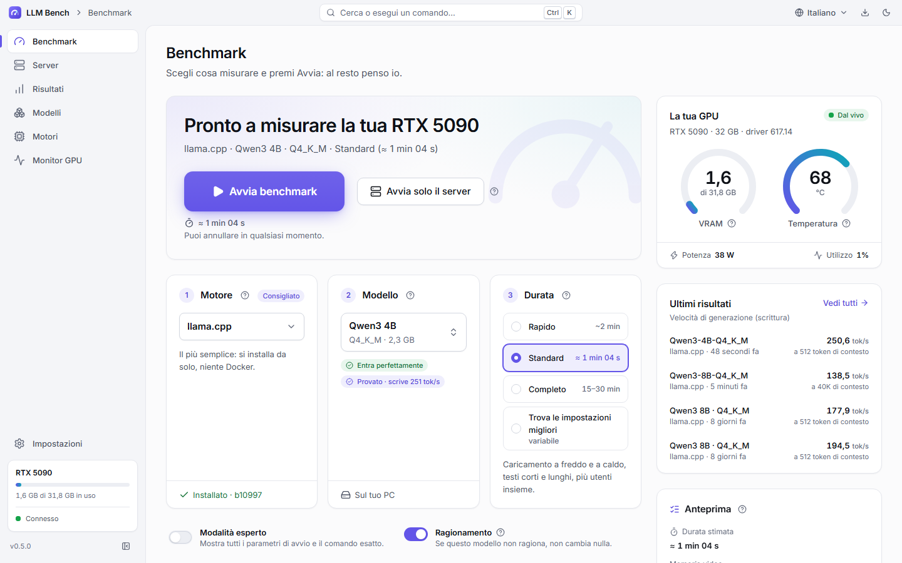
</picture>

Premi **Avvia benchmark**. Se serve scaricare qualcosa, LLM Bench ti mostra cosa e quanto pesa e aspetta il tuo sì. Durante il test vedi in tempo reale le fasi, la velocità, la memoria video, la temperatura e i watt. Puoi annullare in qualsiasi momento.

<picture>
  <source media="(prefers-color-scheme: dark)" srcset="screenshots/it/test-running-dark.png">
  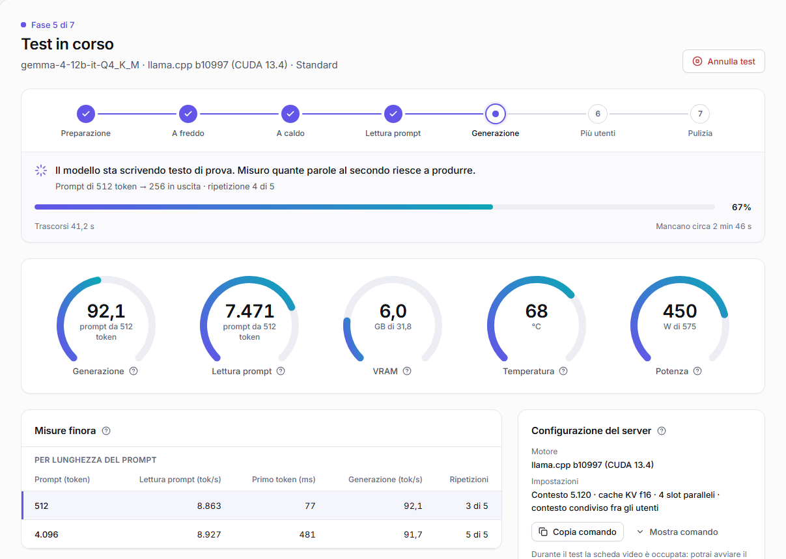
</picture>

Se il motore smette di rispondere (nessuna parola per un minuto), LLM Bench ferma il test con **Il motore non ha risposto in tempo** invece di aspettare per sempre. Se un motore dice che un testo di prova è più lungo del suo contesto, LLM Bench lo rimanda un po' più corto.

### Quando il modello non entra nella scheda (RAM condivisa)

Su Windows, se il modello con il contesto scelto non entra tutto nella memoria video, il driver non dà errore: mette il resto nella **RAM condivisa** del PC e tutto diventa circa 10–15 volte più lento. Quei numeri non sono quelli veri della scheda, quindi LLM Bench ti avvisa:

- **prima del test**, con quanto serve e quanto è libero, e due correzioni con un clic: **Usa cache q4_0** (la memoria del testo occupa circa un quarto) e il **contesto massimo che entra**. Su Linux invece il motore si fermerebbe per memoria esaurita, e l'avviso lo dice;
- **durante il test**, appena se ne accorge, con **Annulla test**;
- **nel risultato**, in cima, con **Trova le impostazioni migliori**, una prova con la cache q4_0 e una con meno contesto.

Questi test sono segnati **RAM condivisa** in Risultati e non contano mai per le stime.

## Leggere un risultato

In cima trovi il punteggio e una frase che lo spiega; sotto, ogni numero con il suo significato. Il **?** accanto a ogni voce lo spiega.

<picture>
  <source media="(prefers-color-scheme: dark)" srcset="screenshots/it/result-dark.png">
  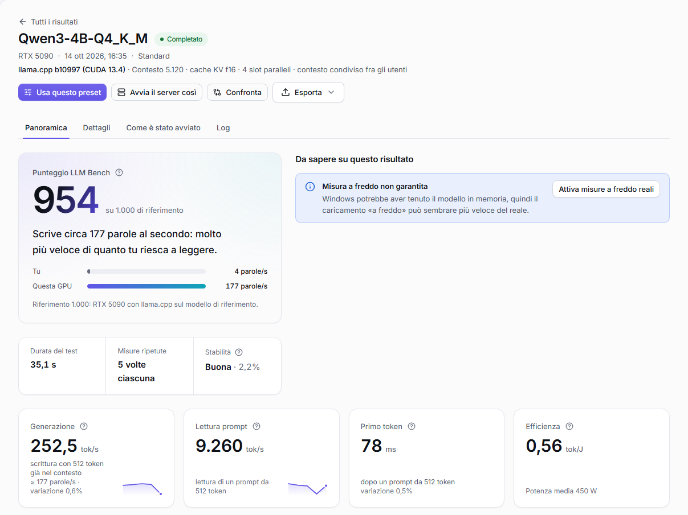
</picture>

| Misura | In parole semplici |
|---|---|
| **Generazione (tok/s)** | Quanto velocemente il modello scrive. Un token è circa 0,7 parole |
| **Lettura prompt (tok/s)** | Quanto velocemente legge il testo che gli dai; conta con i documenti lunghi |
| **Primo token (ms)** | Quanto aspetti prima che compaia la prima parola |
| **Caricamento a freddo** | Il tempo per caricare il modello dal disco la prima volta |
| **Caricamento a caldo** | Il tempo per ricaricarlo quando il PC lo tiene già in memoria |
| **VRAM di picco** | La memoria video usata dal modello nel momento di massimo |
| **Efficienza (tok/J)** | Quanti token per ogni joule di energia: più è alto, meno consuma |
| **Più utenti** | Quanto regge quando più persone lo usano insieme |
| **Punteggio LLM Bench** | Un numero solo per confrontare le schede video: 1.000 è una RTX 5090 con llama.cpp sul modello di riferimento (Qwen3 4B). Si calcola solo con il test Standard su quel modello |

**Ogni velocità dice cosa è stato misurato e con quanto testo**: per esempio «54,6 tok/s · scrittura con 32.768 token già nel contesto» o «2.244 tok/s · lettura di un prompt da 512 token». Più il contesto è pieno, più il modello va piano: per questo un numero senza contesto non basta.

Gli avvisi gialli o azzurri ti dicono se un risultato potrebbe essere falsato (per esempio «altri programmi stavano usando la GPU») e cosa fare. Nella scheda **Come è stato avviato** trovi il comando esatto (PowerShell o bash) da copiare e i pulsanti per **rifare lo stesso test**, **usare le stesse impostazioni** o **avviare solo il server** così.

## Trovare le impostazioni migliori

Scegli la durata **Trova le impostazioni migliori**, poi *Veloce* o *Accurata*. Accanto a ognuna LLM Bench ti dice quanto ci vorrà **per quel modello su questa scheda** (per esempio "~20 min"): un modello piccolo richiede pochi minuti, uno grande con un contesto di 256K anche più di mezz'ora. La stima tiene conto anche dei dischi lenti: un modello letto da una cartella di Windows attraverso WSL (`/mnt/c`) o Docker Desktop si carica più piano.

Poi LLM Bench avvia il modello più volte e prova da solo:

- la **cache KV** (la memoria che tiene il testo già letto): *f16*, poi *q8_0*, poi *q4_0*, che occupa circa un quarto e lascia spazio a molto più contesto;
- il **contesto più grande** che entra tutto nella memoria video, per ogni tipo di cache;
- le impostazioni che cambiano la velocità: *flash attention*, *batch* e *micro-batch* (quanti token del prompt la scheda legge insieme) e, se il modello ha già un file draft o MTP nella libreria, la generazione speculativa.

Misura ogni combinazione **riempiendo il contesto un po' alla volta** (1K, 4K, 8K, 16K… token) fino al suo contesto massimo.

<picture>
  <source media="(prefers-color-scheme: dark)" srcset="screenshots/it/tune-result-dark.png">
  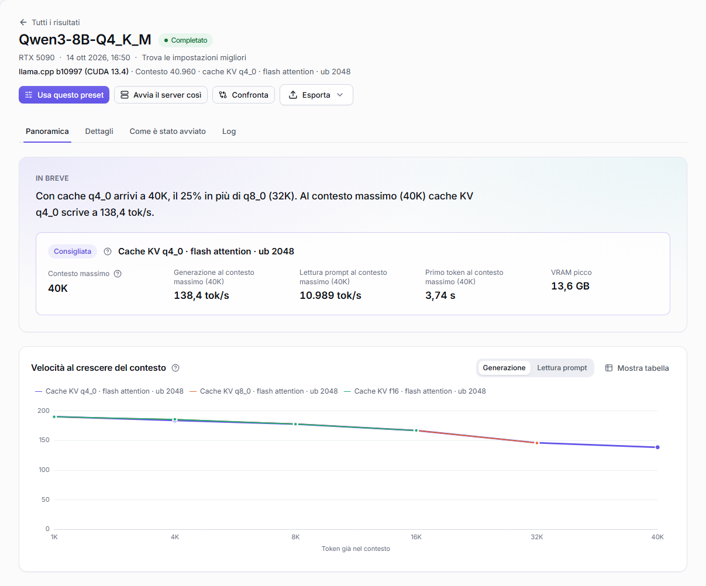
</picture>

Come leggere il risultato:

- **Ogni velocità è letta al contesto massimo, con quel contesto pieno.** È così che va il modello quando usi tutto il contesto che hai impostato.
- La **combinazione consigliata** è la più veloce tra quelle che arrivano al contesto più grande. Il suo riquadro mostra il contesto massimo, la generazione, la lettura del prompt e il primo token con quel contesto, e la VRAM di picco.
- Il **grafico** mostra quanto rallenta ogni combinazione mentre il contesto si riempie.
- La **classifica** mette ogni combinazione al suo contesto massimo: prima il contesto più grande, poi la generazione più veloce. Scegli una profondità in **Confronta a** (1K, 64K…) per confrontarle tutte con il contesto riempito fino lì. Il valore migliore di ogni colonna è in verde; **Misure** apre tutte le misure con il comando esatto.
- **Contesto massimo per tipo di cache** dice fin dove è arrivata ogni cache: "Limite trovato" vuol dire che il contesto subito sopra non entrava; "Almeno …" che più in alto non ha provato.

<picture>
  <source media="(prefers-color-scheme: dark)" srcset="screenshots/it/tune-ranking-dark.png">
  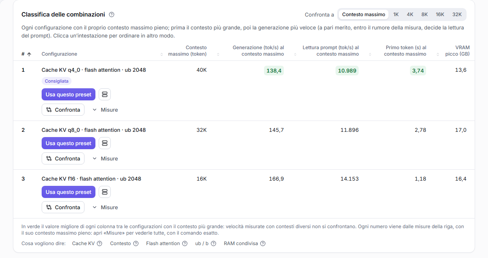
</picture>

**Usa questo preset** porta la combinazione consigliata nella pagina Benchmark o in un server. L'elenco dei Risultati e le Configurazioni mostrano le stesse velocità, al contesto massimo.

La ricerca ha un **tempo massimo** (la sua stima, con un po' di margine). Se il tempo finisce, il risultato tiene quello che ha misurato: le combinazioni **Misurata in parte (tempo finito)** sono confrontate con le stesse regole, e la nota dice perché (per esempio, ogni avvio del motore ha richiesto più del previsto, o il modello è letto attraverso una condivisione lenta). Se annulli, tiene quello che aveva misurato fino a quel momento.

Altre scelte:

- **Più utenti** invece di *Un utente, contesto massimo*: quante persone usano il server insieme e quanto contesto serve a ognuno; conta la velocità che ottiene ciascuno quando tutti lo usano.
- **Ricontrollo rapido**: dopo un aggiornamento del motore, ricarica solo la configurazione consigliata e la seconda e controlla se i numeri tengono ancora.
- In **modalità esperto**: il **Controllo di fedeltà** (lo stesso testo generato con la cache più precisa e con quella consigliata) e **Cerca anche oltre il limite del modello (YaRN)**, fino a 300K, 500K o a un contesto che scegli tu. Oltre il contesto di addestramento la qualità non è garantita: LLM Bench misura solo velocità e memoria.

## Risultati e Confronta

La pagina **Risultati** elenca tutti i test, con filtri per modello, scheda e motore. La vista **Configurazioni** raggruppa i test per modo di avvio (stesso motore, modello, scheda e impostazioni): una riga per configurazione, dalla più veloce, con la mediana dei suoi test. **Confronta a** sceglie la profondità a cui confrontarle; si vedono solo numeri misurati davvero.

<picture>
  <source media="(prefers-color-scheme: dark)" srcset="screenshots/it/results-dark.png">
  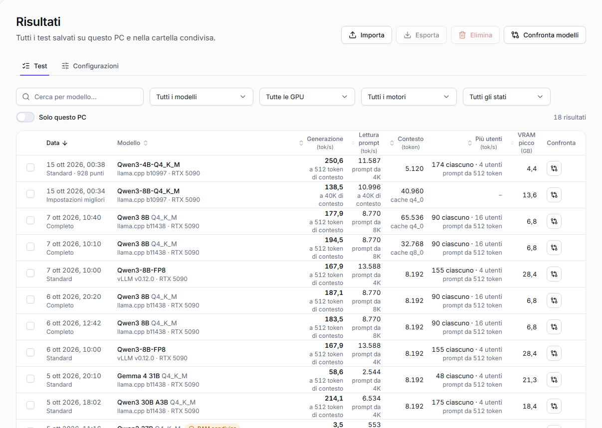
</picture>

Premi **Confronta** accanto a un test, a una configurazione, a una combinazione di *Trova le impostazioni migliori* o in cima a un risultato: una barra in basso raccoglie le tue scelte, fino a 4. **Confronta modelli** (in Risultati) sceglie invece da 2 a 4 modelli: per ognuno LLM Bench prende la configurazione più veloce misurata su questa scheda, e puoi sceglierne un'altra.

Il confronto mette ogni elemento in colonna e, per ogni misura, evidenzia il migliore e dice gli altri a parole («2,2 volte più lento», «−16%»). Le velocità sono sempre confrontate alla **stessa lunghezza di contesto**; dove un elemento non l'ha misurata leggi «non misurato», mai una stima. Ci sono anche i grafici, **Cosa cambia tra loro**, **Usa questo preset** e **Avvia il server così** per ognuno, e la **Scheda da condividere**. L'indirizzo della pagina contiene il confronto: puoi riaprirlo o condividerlo così com'è.

<picture>
  <source media="(prefers-color-scheme: dark)" srcset="screenshots/it/compare-dark.png">
  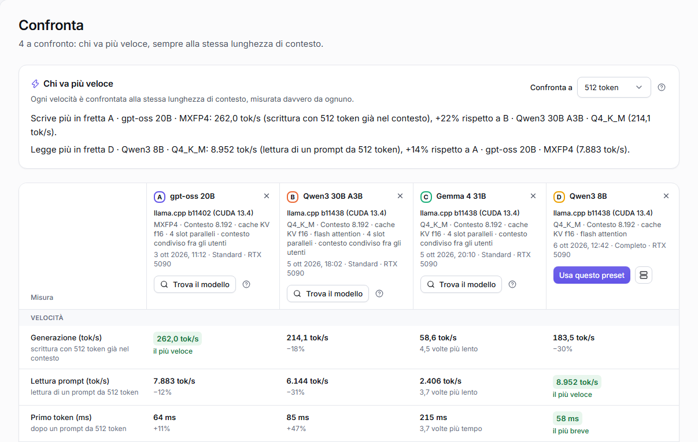
</picture>

Puoi **esportare** i risultati in CSV (anche nel formato per Excel italiano), JSON, Markdown o HTML.

## Modelli

Nella pagina **Modelli**:

- **Sul tuo PC**: i modelli che hai, divisi per formato (per llama.cpp, per vLLM / SGLang, per NInfer), con quanto spazio occupano e come sono andati. Un download fermato a metà compare come **Incompleto · 1 di 4 file**: riprendilo o eliminalo.
- **Scarica**: i consigliati per la tua scheda e la ricerca su Hugging Face, con filtri per motore, dimensione ed **Entra nella mia GPU**.

Ogni modello mostra i suoi **formati**, ognuno con il motore che lo usa: **GGUF · llama.cpp**, **Safetensors · vLLM / SGLang**, **NInfer · solo RTX 5090**. LLM Bench sceglie da solo la **versione** (quantizzazione) migliore che entra nella tua scheda, segnata **Consigliata**; puoi sceglierne un'altra.

<p align="center"><picture>
  <source media="(prefers-color-scheme: dark)" srcset="screenshots/it/model-versions-dark.png">
  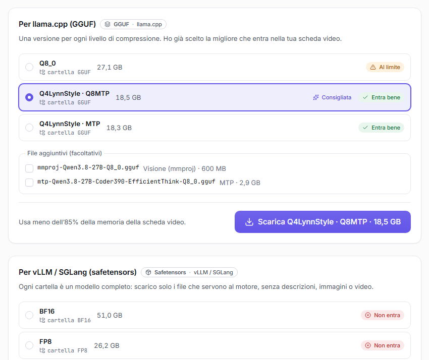
</picture></p>

- I download si mettono in pausa e riprendono da soli se la connessione cade. Quello che hai già non si riscarica mai: se scegli una versione già sul PC, scarica solo le parti che mancano (per esempio la parte visione).
- **Aggiornamenti**: LLM Bench guarda su Hugging Face se qualcosa è cambiato quando premi **Controlla aggiornamenti** e, da solo, al massimo una volta al giorno. **Aggiornamento disponibile** dice cosa è cambiato, e **Aggiorna** scarica solo i file cambiati.
- Per i modelli con una licenza da accettare (per esempio Llama o Gemma) LLM Bench apre la pagina giusta e ti chiede una volta il token di Hugging Face, che salva cifrato.
- **Comandi per questo modello**: alcuni modelli vogliono comandi speciali presi dalla loro scheda (un contesto più lungo con YaRN, un file MTP, un fork del motore). Scrivili una volta, o scegli una ricetta pronta: Benchmark, *Trova le impostazioni migliori* e *Avvia solo il server* li usano da soli.

## Server e area di notifica

Vuoi usare un modello in una chat, un editor o un assistente, senza test? Apri **Server** nella barra laterale e premi **Avvia un server** (ci arrivi anche da **Avvia solo il server** nella pagina Benchmark e da **Avvia il server così** in un risultato). In quattro passi:

1. **Modello**: quelli sul tuo PC partono subito, i consigliati vengono scaricati prima.
2. **Motore**: llama.cpp, vLLM, SGLang, NInfer o un motore personalizzato.
3. **Impostazioni**: le migliori dai tuoi test, uno dei tuoi preset o le tue (contesto, cache, argomenti in più).
4. **Porta e rete**: sempre la stessa porta, così i tuoi programmi la ritrovano.

A destra vedi sempre cosa verrà avviato, se entra nella memoria video e il **comando esatto**. Poi premi **Avvia**.

<picture>
  <source media="(prefers-color-scheme: dark)" srcset="screenshots/it/server-dark.png">
  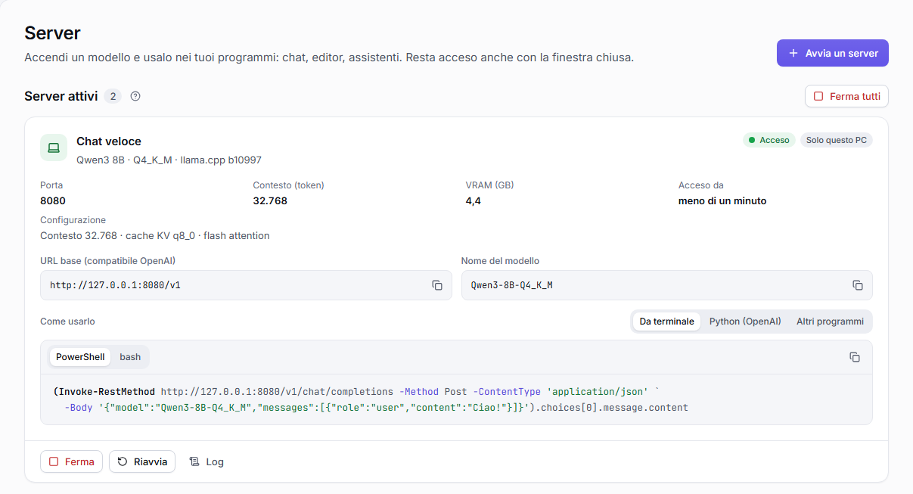
</picture>

Ogni server acceso ha l'**URL base** e il **nome del modello** da copiare (compatibili con OpenAI), esempi pronti (terminale, Python con la libreria OpenAI, le tre impostazioni da incollare in Open WebUI, Continue o Chatbox), la memoria video, **Ferma**, **Riavvia** e il log. Mentre un server è acceso non puoi fare benchmark: LLM Bench ti propone di fermarlo prima.

- **Preset**: **Salva come preset** ricorda modello, motore, impostazioni e porta. Segna **Avvia all'apertura di LLM Bench** per farlo partire da solo.
- **Rete locale (avanzato)**: di solito un server risponde solo a questo PC. **Rendi raggiungibile dalla rete locale** lo fa usare anche agli altri dispositivi, con una **chiave API** che LLM Bench genera e salva cifrata. Attivalo solo su reti di cui ti fidi.

**L'area di notifica.** Se chiudi la finestra mentre un server è acceso, LLM Bench resta vicino all'orologio e il server continua a funzionare. Dall'icona riapri la finestra, copi l'indirizzo di un server, lo fermi o lo riavvii, avvii un preset, fermi tutti i server o esci. Su Windows il menu dice anche com'è Docker, con **Avvia Docker** o **Riavvia Docker**.

<p align="center"><picture>
  <source media="(prefers-color-scheme: dark)" srcset="screenshots/it/tray-menu-dark.png">
  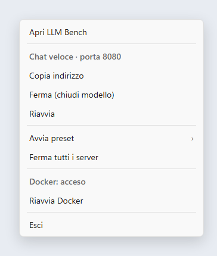
</picture></p>

In **Impostazioni → Area di notifica** scegli cosa fa la chiusura della finestra e attivi **Avvia LLM Bench all'accesso**.

## Motori

I motori sono i programmi che fanno girare i modelli. Ognuno ha la sua scheda nella pagina **Motori**, con lo stato, le versioni e i pulsanti per installare e **Aggiorna**. Prima di aggiornare LLM Bench ti mostra i comandi esatti che eseguirà; la versione di prima resta sul PC finché la nuova non funziona.

Quello che LLM Bench installa si toglie dalla stessa scheda, dopo una conferma che dice cosa va via (e, dove può, quanto spazio libera): una versione di llama.cpp, una versione Docker segnata **Sul PC** (vLLM, SGLang, l'immagine di llama.cpp), una compilazione di NInfer fatta da lui (la sua cartella), l'ambiente Python di vLLM o SGLang su Linux. Niente viene tolto mentre un test o un server lo sta usando. Una compilazione o un ambiente tuo viene solo **dimenticato**: LLM Bench smette di usarlo e i suoi file restano.

<picture>
  <source media="(prefers-color-scheme: dark)" srcset="screenshots/it/engines-dark.png">
  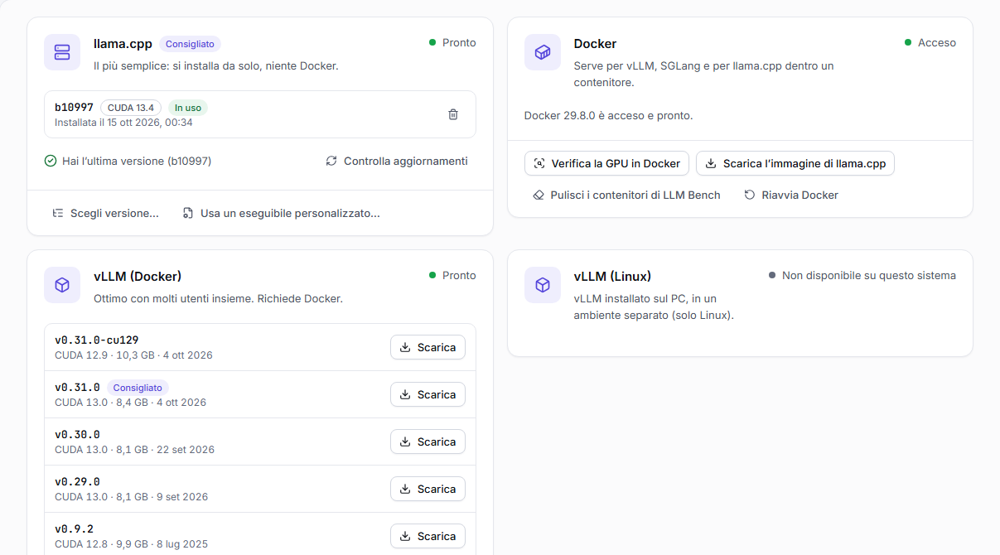
</picture>

- **llama.cpp**: il predefinito. LLM Bench lo scarica al primo test; legge i modelli GGUF.
- **Docker, vLLM e SGLang**: vLLM e SGLang servono molti utenti insieme e leggono le cartelle Hugging Face (safetensors), non i file GGUF. Su Windows funzionano in Docker Desktop: se Docker manca, la pagina Motori lo installa; se è spento, **Avvia Docker** lo accende. Su Linux funzionano in Docker o installati sul PC, in un ambiente Python che LLM Bench prepara. Su Windows, **Copia nello spazio Docker** copia un modello una volta nello spazio di Docker, così si carica molto più in fretta.
- **Quando Docker non risponde**: di solito il *Resource Saver* di Docker Desktop si è bloccato mentre lo spegneva. **Riavvia Docker** lo riavvia; immagini, modelli e contenitori restano, e i server di LLM Bench ripartono con le stesse impostazioni. Per evitarlo, disattiva Resource Saver in Docker Desktop → Impostazioni → Resources → Advanced. LLM Bench non cambia mai da solo le impostazioni di Docker.
- **Motori personalizzati**: sotto **Motori personalizzati** premi **Aggiungi motore**: un fork di llama.cpp, vLLM o SGLang, una **Variante di NInfer** o un **Programma con API OpenAI**. Dici a LLM Bench dove si trova e lui lo prova (`--version`, `--help`) prima di usarlo.
- **Fork con cache KV proprie**: un fork di llama.cpp che aggiunge tipi di cache KV (per esempio `turbo4`, `turbo3`, `turbo2` di TurboQuant) viene riconosciuto da solo dal suo `--help`. La scelta della cache KV nel Benchmark e in *Avvia solo il server* li elenca con la loro dimensione, la stima della memoria li conta (un tipo che LLM Bench non conosce è calcolato come f16: "stima non disponibile") e *Trova le impostazioni migliori* li prova dopo q4_0: *Veloce* i due più compatti, *Accurata* tutti.
- **NInfer (solo RTX 5090)**: un motore fatto per i modelli Qwen 3.6 e 3.8 su una sola RTX 5090, che legge i modelli `.ninfer`. Funziona su Linux, oppure dentro WSL 2 su Windows. La sua scheda ha due versioni: **NInfer** ufficiale e **NInfer-all**, che legge anche i modelli GGUF-NInfer (LLM Bench la sceglie da solo quando un modello ne ha bisogno). **Scarica e compila** controlla prima cosa serve (git, CMake, un compilatore C++, CUDA…) ed elenca quello che manca con il comando da copiare. NInfer-all sulla RTX 5090 vuole **CUDA 13.1 o più recente**. Con i modelli `.ninfer` la pagina Benchmark offre impostazioni pronte.

### Un tuo programma con API OpenAI

Qualsiasi programma che risponde come OpenAI (`/v1/models`, `/v1/completions` o `/v1/chat/completions`) si può misurare, anche se LLM Bench non lo conosce.

1. **Motori → Aggiungi motore → Programma con API OpenAI**, dagli un nome.
2. Scrivi il **comando che avvia il server**, come in un terminale, oppure premi uno degli esempi (**Un server come llama.cpp**, **Un server come vLLM**, **Uno script Python, con preparazione e pulizia**) e modificalo. A destra vedi tutti i comandi con valori di esempio mentre scrivi.
3. Usa i **segnaposto**: LLM Bench scrive il valore al loro posto. `{port}` serve sempre (la porta la sceglie LLM Bench); `{model}`, `{modelDir}`, `{host}` e `{alias}` dicono dov'è il modello e come rispondere. Gli altri portano le impostazioni di LLM Bench: `{ctx}` il contesto, `{kv}` il tipo di cache KV, `{parallel}` gli utenti insieme, `{gpuLayers}` i layer sulla GPU, `{batch}` e `{ubatch}`. Per esempio:

   ```
   mio-server --model {model} --port {port} --context {ctx} --cache {kv}
   ```

   Con `{kv}` spunti i tipi che accetta (scritti come li vuole il tuo programma). Un segnaposto che LLM Bench non conosce viene rifiutato quando salvi, dicendo quale.
4. **Comandi prima e dopo il server** (facoltativi, uno per riga): quelli prima partono in ordine prima di ogni avvio e devono finire senza errori (preparare una cartella, scaricare, scaldare); quelli dopo partono dopo ogni arresto, per fare pulizia. Quello che scrivono finisce nel log del test; se uno di quelli prima non riesce, il test si ferma e dice quale.
5. **Prova** controlla i comandi e cerca i loro programmi, senza avviare niente. **Salva**, poi **Usa nel Benchmark**.

Nella pagina Benchmark, la modalità esperto mostra **solo le impostazioni che i tuoi comandi usano**, con i loro nomi di sempre; il resto delle impostazioni di un motore non vale. **Trova le impostazioni migliori** c'è quando un comando usa `{ctx}`: prova i contesti e, con `{kv}`, i tipi di cache che hai spuntato (con `{ubatch}` / `{batch}` anche quelli). Risultati e Configurazioni mostrano le impostazioni arrivate al tuo programma.

Ogni comando parte da solo, **senza shell**: un valore con spazi resta un solo argomento e nessuna shell lo legge, e un ambiente attivato in un comando non è attivo nel successivo (scrivi invece il percorso completo del programma dell'ambiente, per esempio `C:\envs\mio\python.exe`). Un file `.bat` o `.cmd` si avvia con `cmd /c file.bat …`.

## Impostazioni utili

- **Lingua**: English o Italiano, anche dal globo nella barra del titolo.
- **Misure a freddo reali**: per misurare davvero il caricamento dal disco, il modello non deve essere già nella memoria del PC. Su Linux non serve nulla. Su Windows attivale una volta in **Impostazioni → Misure a freddo reali** (Windows chiede una sola volta il permesso di amministratore). Senza, i risultati portano l'avviso «Misura a freddo non garantita».
- **Cartella dei risultati**: scegli una cartella condivisa o sincronizzata (OneDrive, Syncthing, una cartella di rete) per vedere insieme i risultati di più PC. Ogni PC scrive i suoi file, quindi non ci sono conflitti.
- **Cartelle dei modelli**: aggiungi le cartelle dove tieni i modelli.
- **Modalità esperto** (nella pagina Benchmark): imposti a mano contesto, strati sulla GPU, flash attention, tipo di cache, batch, thread, richieste parallele, argomenti in più e variabili d'ambiente. L'**Anteprima comando** mostra sempre la riga esatta che verrà eseguita.

## Problemi comuni

| Problema | Cosa fare |
|---|---|
| «Driver NVIDIA non installato» o «Driver NVIDIA troppo vecchio» | Premi il pulsante che apre la pagina di NVIDIA, installa l'ultimo driver e premi **Ricontrolla** |
| «La memoria della scheda video è occupata» | Chiudi gli altri programmi che usano la GPU (giochi, altri modelli, macchine virtuali) oppure premi **Continua comunque** |
| «Memoria della scheda video insufficiente» | Scegli un modello più piccolo o una versione più compressa; in modalità esperto riduci il contesto |
| Il modello non entra nella memoria video (test lento) | Usa la cache q4_0, meno contesto o **Trova le impostazioni migliori** ([dettagli](#quando-il-modello-non-entra-nella-scheda-ram-condivisa)) |
| «Il motore non ha risposto in tempo» | Riprova; se succede ancora, probabilmente il modello non entra nella memoria video: usa la cache q4_0, meno contesto o **Trova le impostazioni migliori** |
| «Questa versione del motore non sa leggere il modello» | Premi **Aggiorna** sulla scheda del motore, oppure usa la variante che il messaggio propone (per i modelli GGUF-NInfer: **Scarica e compila NInfer-all e riprova**) |
| «Docker non è avviato» | Premi **Avvia Docker** |
| «Docker non risponde» | Premi **Riavvia Docker**; per evitarlo disattiva il Resource Saver di Docker Desktop |
| «Serve accettare la licenza del modello» | Apri la pagina del modello su Hugging Face, accetta e salva il tuo token in Impostazioni |
| *Trova le impostazioni migliori* si è fermato prima: tempo finito | Il risultato tiene quello che ha misurato e dice perché. Se il modello sta in una cartella di Windows letta da WSL o Docker, spostalo sul disco di Linux (la pagina Motori ti dice come) e rifai la ricerca |

---

Le idee per la stima della memoria video vengono in parte da [llmfit](https://github.com/AlexsJones/llmfit) (licenza MIT).
