# LLM Bench guide

English · [Italiano](GUIDA.md) · [Back to the README](../README.md)

LLM Bench measures how fast your NVIDIA graphics card runs AI language models (LLMs) on your own PC. It downloads and starts the models, makes them work on test texts and tells you, in plain words, how fast they are and which settings suit your card best.

You don't need to know anything technical: LLM Bench installs what is missing by itself and asks before downloading anything. This guide follows the app screen by screen.

**Contents:** [Install](#install) · [First start](#first-start) · [Run a benchmark](#run-a-benchmark) · [Read a result](#read-a-result) · [Find the best settings](#find-the-best-settings) · [Results and Compare](#results-and-compare) · [Models](#models) · [Servers and the notification area](#servers-and-the-notification-area) · [Engines](#engines) · [Settings worth knowing](#settings-worth-knowing) · [Troubleshooting](#troubleshooting)

## Install

**Windows:** open `LLM-Bench-Setup-x.y.z.exe` and follow the steps. Windows asks once for administrator permission: LLM Bench installs into *Program Files* for every user of the PC, and uninstalls like any program from **Settings → Apps → Installed apps** (your results stay in `%APPDATA%\LLM Bench`). If you prefer not to install anything, use the *portable* version (`LLM-Bench-x.y.z-portable.exe`).

> The first time, Windows may show "Windows protected your PC": click **More info** → **Run anyway**. This happens with new programs that are not widely known yet.

**Linux** (Ubuntu, Debian and derivatives): open `llm-bench-x.y.z-amd64.deb` with your package manager, or run `sudo apt install ./llm-bench-x.y.z-amd64.deb` in a terminal. On other distributions use the AppImage.

The only thing that must already be there is the **NVIDIA driver**. If it is missing or too old, LLM Bench tells you and takes you to the right download page.

### From GPU Bench to LLM Bench

Up to version 0.3 the app was called **GPU Bench**. At its first start LLM Bench takes over your data and tells you once:

- results, settings, presets, installed engines and your Hugging Face token move to LLM Bench's folder (`%APPDATA%\LLM Bench` on Windows, `~/.config/LLM Bench` on Linux). If GPU Bench is still open, LLM Bench copies its data and leaves its folder as it was;
- **models stay where they are**: if you used the default folder (`GPU Bench\models` in your user folder), LLM Bench keeps using it;
- if GPU Bench started at login, LLM Bench now starts instead;
- on Linux, if the Hugging Face token can no longer be read (the system keyring ties it to the app name), LLM Bench removes it and asks you to enter it again.

Older tests still say "GPU Bench 0.3": that is their history. You can uninstall GPU Bench whenever you like.

## First start

The **Welcome** screen checks your PC and shows a traffic-light list:

| Item | What it means |
|---|---|
| NVIDIA driver | The driver version and the CUDA version it supports |
| Graphics card | The card's model and how much video memory (VRAM) it has |
| llama.cpp engine | The program that runs the models. If it is missing, a button installs it (about 500 MB) |
| Models | The models already on your PC (LM Studio, Ollama and Hugging Face folders too) |
| Disk space | The free space in the models folder |
| Docker | Optional: only for vLLM and SGLang (and llama.cpp in a container) |

Every red or orange item has **one button** that fixes it. Then LLM Bench suggests a setup for your card: the llama.cpp engine, a model that fits and a *Quick* test.

LLM Bench starts in English: the **English / Italiano** switch at the top of the Welcome screen changes the language at once. Later you find the same choice in the globe of the title bar and in **Settings**.

<picture>
  <source media="(prefers-color-scheme: dark)" srcset="screenshots/en/first-start-dark.png">
  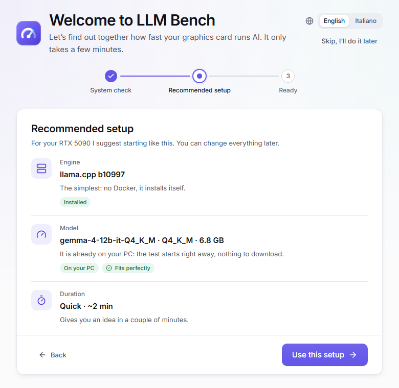
</picture>

## Run a benchmark

On the **Benchmark** page, choose three things:

1. **Engine:** keep *llama.cpp* (recommended) if you are not sure.
2. **Model:** the models recommended for your card have a coloured label: **Fits perfectly** or **Fits well** (no problem), **Tight fit** (close other programs first), **Fits partially** (works, but slower), **Does not fit** (too big for your card). **Tried on this GPU** means you already measured it, with its speed.
3. **Duration:** *Quick* (about 2 minutes), *Standard* (about 6 minutes; on the reference model it gives the LLM Bench score), *Full* (15–30 minutes) or *Find the best settings* (LLM Bench tells you how long before it starts, see [below](#find-the-best-settings)).

<picture>
  <source media="(prefers-color-scheme: dark)" srcset="screenshots/en/benchmark-dark.png">
  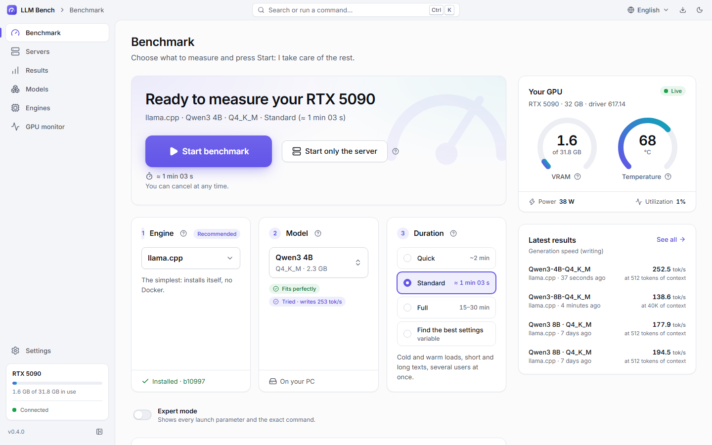
</picture>

Press **Start benchmark**. If something must be downloaded, LLM Bench shows what and how big, and waits for your OK. During the test you see the phases, the speed, video memory, temperature and watts live. You can cancel at any time.

<picture>
  <source media="(prefers-color-scheme: dark)" srcset="screenshots/en/test-running-dark.png">
  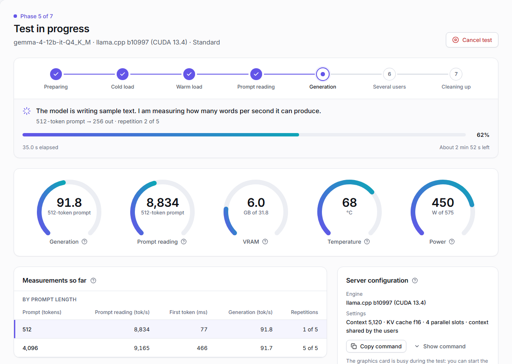
</picture>

If the engine stops answering (no word for a minute), LLM Bench stops the test with **The engine did not answer in time** instead of waiting forever. If an engine says a test prompt is longer than its context, LLM Bench sends it again a little shorter.

### When the model does not fit (shared RAM)

On Windows, if the model with the chosen context does not fit entirely in video memory, the driver gives no error: it moves the rest into the PC's **shared RAM** and everything becomes about 10–15 times slower. Those numbers are not your card's real ones, so LLM Bench warns you:

- **before the test**, with what is needed and what is free, and two one-click fixes: **Use q4_0 cache** (the text memory takes about a quarter) and the **largest context that fits**. On Linux the engine would stop for lack of memory instead, and the warning says so;
- **during the test**, as soon as it notices, with **Cancel test**;
- **in the result**, at the top, with **Find the best settings**, a retry with the q4_0 cache and a retry with less context.

These tests are marked **Shared RAM** in Results and never count for estimates.

## Read a result

At the top you find the score and a sentence that explains it; below, every number with its meaning. The **?** next to each item explains it.

<picture>
  <source media="(prefers-color-scheme: dark)" srcset="screenshots/en/result-dark.png">
  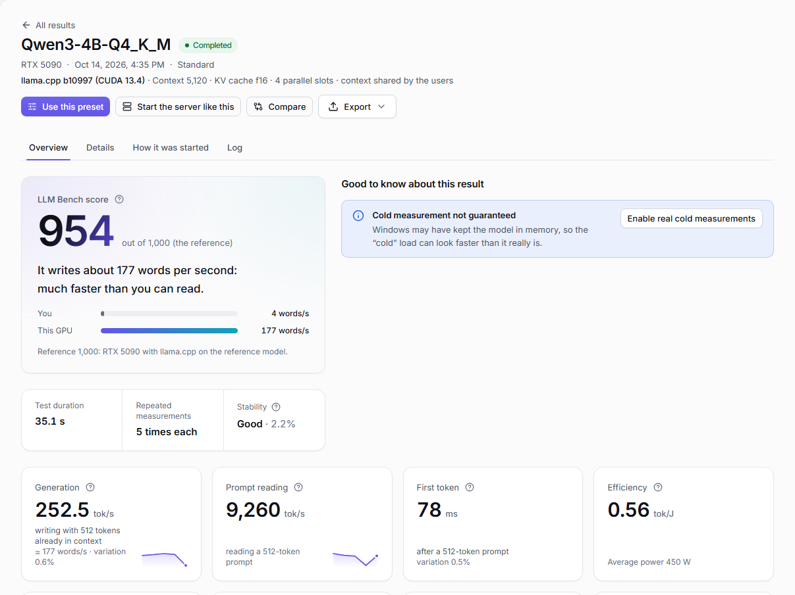
</picture>

| Measurement | In plain words |
|---|---|
| **Generation (tok/s)** | How fast the model writes. A token is about three quarters of a word |
| **Prompt reading (tok/s)** | How fast it reads the text you give it; it matters with long documents |
| **First token (ms)** | How long you wait before the first word appears |
| **Cold load** | The time to load the model from disk the first time |
| **Warm load** | The time to load it again when the PC already holds it in memory |
| **Peak VRAM** | The most video memory the model used |
| **Efficiency (tok/J)** | Tokens per joule of energy: higher means it uses less power |
| **Several users** | How well it copes when several people use it at once |
| **LLM Bench score** | One number to compare graphics cards: 1,000 is an RTX 5090 with llama.cpp on the reference model (Qwen3 4B). Only a Standard test of that model gets one |

**Every speed says what was measured and with how much text**: for example "54.6 tok/s · writing with 32,768 tokens already in context" or "2,244 tok/s · reading a 512-token prompt". The fuller the context, the slower the model: that is why a number without its context is not enough.

Yellow or blue notes tell you when a result may be skewed (for example "other programs were using the GPU") and what to do. The **How it was started** tab has the exact command (PowerShell or bash) to copy, and buttons to **run the same test again**, **use the same settings** or **start only the server** like this.

## Find the best settings

Choose the duration **Find the best settings**, then *Fast* or *Thorough*. Next to each, LLM Bench tells you how long it will take **for that model on this card** (for example "~20 min"): a small model takes a few minutes, a large one with a 256K context can take more than half an hour. The estimate counts slow disks too: a model read from a Windows folder through WSL (`/mnt/c`) or through Docker Desktop loads more slowly.

LLM Bench then starts the model several times and tries by itself:

- the **KV cache** (the memory that keeps the text already read): *f16*, then *q8_0*, then *q4_0*, which takes about a quarter and leaves room for much more context;
- the **largest context** that fits entirely in video memory, for each cache type;
- the settings that change the speed: *flash attention*, *batch* and *micro-batch* (how many prompt tokens the card reads at once) and, if the model has a draft or MTP file in your library, speculative decoding.

It measures each combination **filling the context step by step** (1K, 4K, 8K, 16K… tokens) up to its largest context.

<picture>
  <source media="(prefers-color-scheme: dark)" srcset="screenshots/en/tune-result-dark.png">
  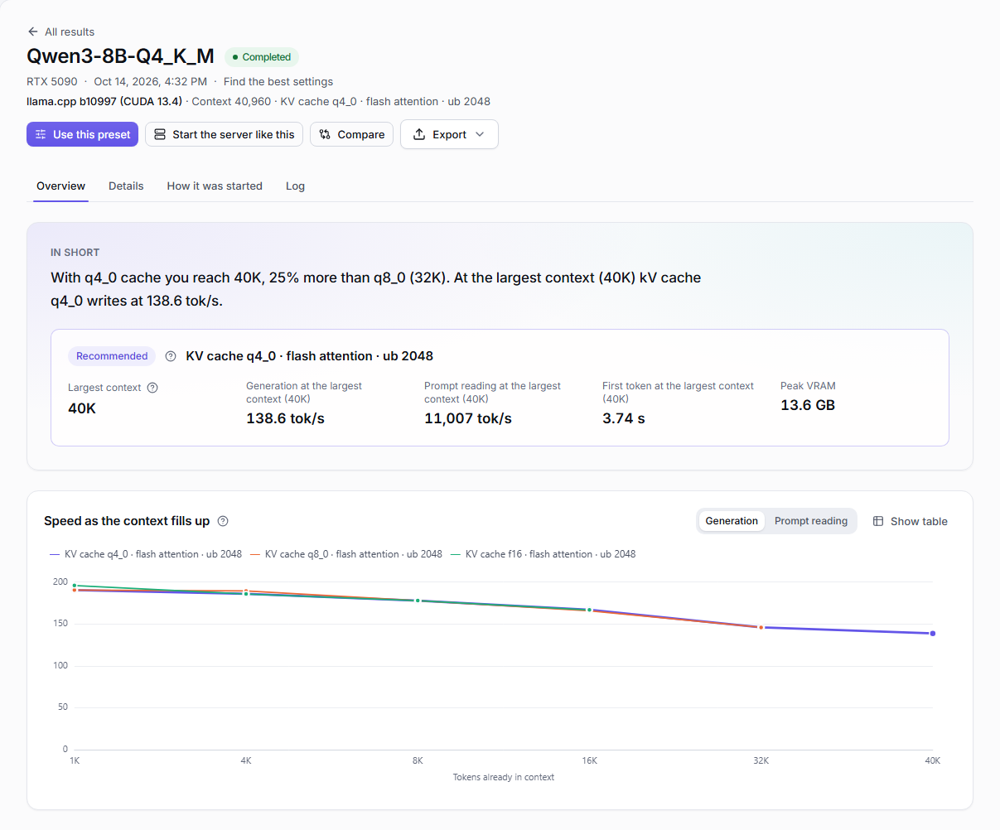
</picture>

How to read the result:

- **Every speed is read at the largest context, with that context full.** That is how the model runs when you use all the context you set.
- The **recommended combination** is the fastest among those that reach the largest context. Its card shows the largest context, generation, prompt reading and first token at that context, and peak VRAM.
- The **chart** shows how each combination slows down as the context fills.
- The **ranking** lists every combination at its own largest context: the largest context first, then the fastest generation. Choose a depth in **Compare at** (1K, 64K…) to compare them all with the context filled up to there. The best value in each column is green; **Measurements** opens every measurement with its exact command.
- **Largest context per cache type** says how far each cache went: "Limit found" means the next context up did not fit; "At least …" means it did not try higher.

<picture>
  <source media="(prefers-color-scheme: dark)" srcset="screenshots/en/tune-ranking-dark.png">
  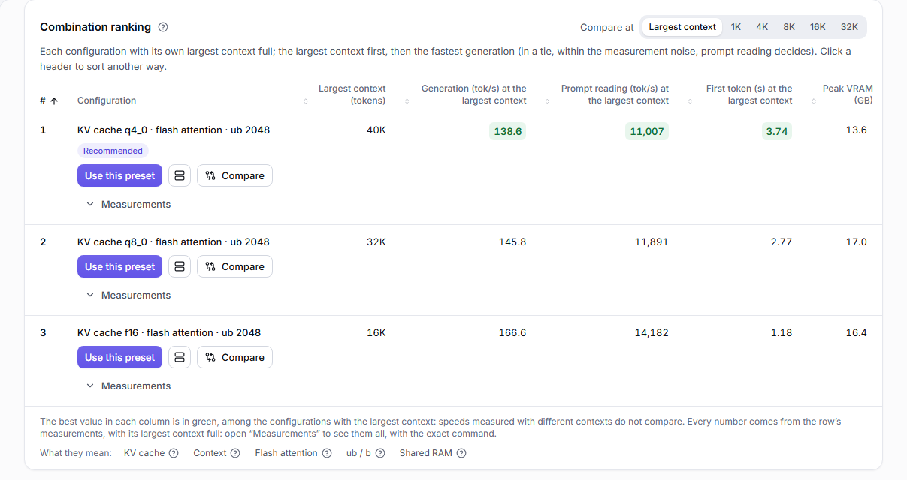
</picture>

**Use this preset** takes the recommended combination to the Benchmark page or to a server. The Results list and Configurations show the same speeds, at the largest context.

The search has a **time limit** (its estimate, with some margin). If the time runs out, the result keeps what it measured: combinations marked **Partly measured (time is up)** are compared by the same rules, and the note says why (for example, each engine start took longer than expected, or the model is read through a slow share). If you cancel, it keeps what it had measured so far.

Other options:

- **Several users** instead of *One user, largest context*: how many people use the server at once and how much context each one needs; what counts is the speed each one gets when everyone is busy.
- **Quick recheck**: after an engine update, it reloads only the recommended configuration and the runner-up and checks whether the numbers still hold.
- In **expert mode**: the **Fidelity check** (the same text generated with the most precise cache and the recommended one) and **Also search beyond the model's limit (YaRN)**, up to 300K, 500K or a context you choose. Beyond the training context, quality is not guaranteed: LLM Bench measures only speed and memory.

## Results and Compare

The **Results** page lists every test, with filters for model, card and engine. The **Configurations** view groups tests by how the model was started (same engine, model, card and settings): one row per configuration, fastest first, with the median of its tests. **Compare at** picks the depth to compare them at; only numbers that were really measured are shown.

<picture>
  <source media="(prefers-color-scheme: dark)" srcset="screenshots/en/results-dark.png">
  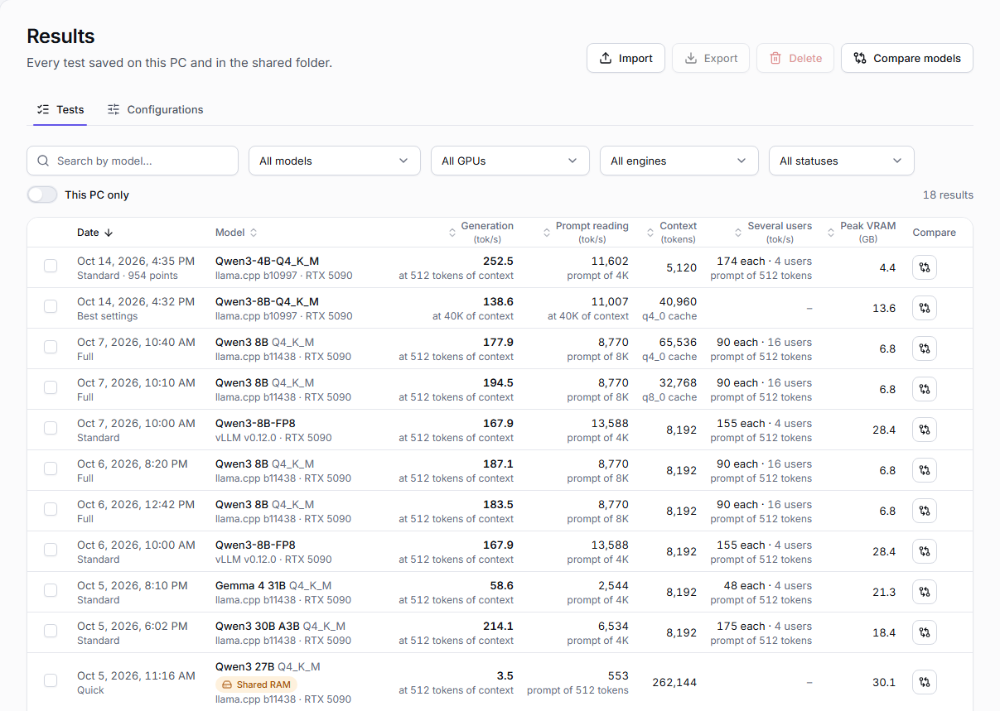
</picture>

Press **Compare** next to a test, a configuration, a combination of *Find the best settings* or at the top of a result: a bar at the bottom collects your choices, up to 4. **Compare models** (on Results) picks 2 to 4 models instead: for each one LLM Bench takes the fastest configuration measured on this card, and you can choose another.

The comparison puts each item in a column and, for every measurement, highlights the best and says the others in words ("2.2 times slower", "−16%"). Speeds are always compared at the **same context length**; where an item did not measure it, you read "not measured", never an estimate. You also get charts, **What changes between them**, **Use this preset** and **Start the server like this** for each item, and a **Shareable sheet**. The page address holds the comparison: reopen or share it as it is.

<picture>
  <source media="(prefers-color-scheme: dark)" srcset="screenshots/en/compare-dark.png">
  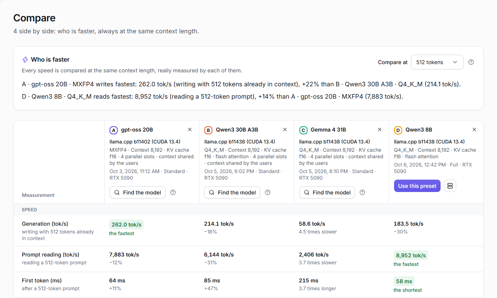
</picture>

You can **export** results to CSV (also in the format for Excel in Italian), JSON, Markdown or HTML.

## Models

On the **Models** page:

- **On your PC**: the models you have, grouped by format (for llama.cpp, for vLLM / SGLang, for NInfer), with their size and how they did. A download stopped halfway shows as **Incomplete · 1 of 4 files**: resume it or delete it.
- **Download**: the models recommended for your card and the Hugging Face search, with filters for engine, size and **Fits my GPU**.

Each model shows its **formats**, each with the engine that uses it: **GGUF · llama.cpp**, **Safetensors · vLLM / SGLang**, **NInfer · RTX 5090 only**. LLM Bench picks the best **version** (quantization) that fits your card, marked **Recommended**; you can choose another.

<picture>
  <source media="(prefers-color-scheme: dark)" srcset="screenshots/en/model-versions-dark.png">
  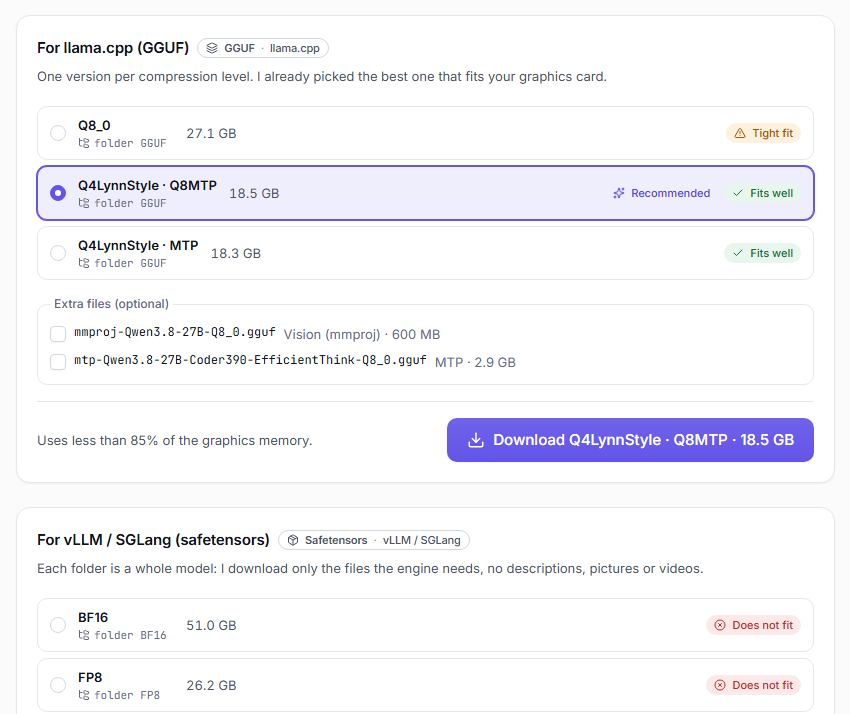
</picture>

- Downloads pause and resume by themselves if the connection drops. What you already have is never downloaded again: if you pick a version already on the PC, only the missing parts are fetched (for example the vision part).
- **Updates:** LLM Bench checks Hugging Face for changes when you press **Check for updates** and by itself at most once a day. **Update available** says what changed, and **Update** downloads only the changed files.
- For models with a license to accept (for example Llama or Gemma), LLM Bench opens the right page and asks once for your Hugging Face token, stored encrypted.
- **Commands for this model**: some models need special commands from their model card (a longer context with YaRN, an MTP file, a fork of the engine). Write them once, or pick a ready-made recipe: Benchmark, *Find the best settings* and *Start only the server* use them by themselves.

## Servers and the notification area

Want to use a model in a chat, an editor or an assistant, without a test? Open **Servers** in the sidebar and press **Start a server** (you also get there from **Start only the server** on the Benchmark page and **Start the server like this** on a result). In four steps:

1. **Model:** the ones on your PC start at once; recommended ones are downloaded first.
2. **Engine:** llama.cpp, vLLM, SGLang, NInfer or a custom engine.
3. **Settings:** the best from your tests, one of your presets, or your own (context, cache, extra arguments).
4. **Port and network:** always the same port, so your apps find it again.

On the right you always see what will start, whether it fits in video memory and the **exact command**. Then press **Start**.

<picture>
  <source media="(prefers-color-scheme: dark)" srcset="screenshots/en/server-dark.png">
  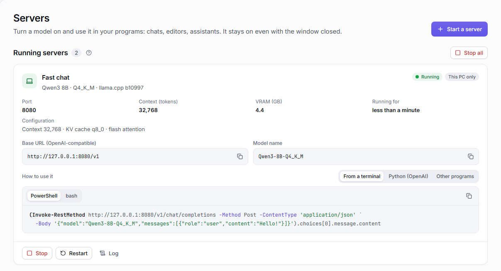
</picture>

Each running server shows its **base URL** and **model name** to copy (OpenAI-compatible), ready examples (terminal, Python with the OpenAI library, the three settings to paste into Open WebUI, Continue or Chatbox), video memory, **Stop**, **Restart** and the log. While a server is running you cannot run benchmarks: LLM Bench offers to stop it first.

- **Presets:** **Save as preset** remembers model, engine, settings and port. Mark **Start when LLM Bench opens** to start it by itself.
- **Local network (advanced):** a server normally answers only this PC. **Make it reachable from the local network** lets other devices use it with an **API key** LLM Bench creates and stores encrypted. Turn it on only on networks you trust.

**The notification area.** Close the window while a server is running and LLM Bench stays next to the clock, with the server still working. From its icon you reopen the window, copy a server's address, stop or restart it, start a preset, stop all servers or quit. On Windows the menu also shows Docker's state, with **Start Docker** or **Restart Docker**.

<picture>
  <source media="(prefers-color-scheme: dark)" srcset="screenshots/en/tray-menu-dark.png">
  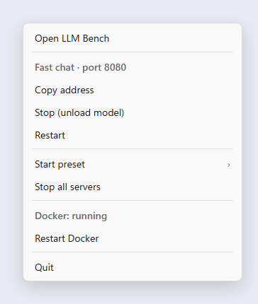
</picture>

In **Settings → Notification area** you choose what closing the window does and turn on **Start LLM Bench at login**.

## Engines

Engines are the programs that run the models. Each one has a card on the **Engines** page with its state, its versions and the buttons to install and **Update**. Before updating, LLM Bench shows the exact commands it will run; the previous version stays on the PC until the new one works.

<picture>
  <source media="(prefers-color-scheme: dark)" srcset="screenshots/en/engines-dark.png">
  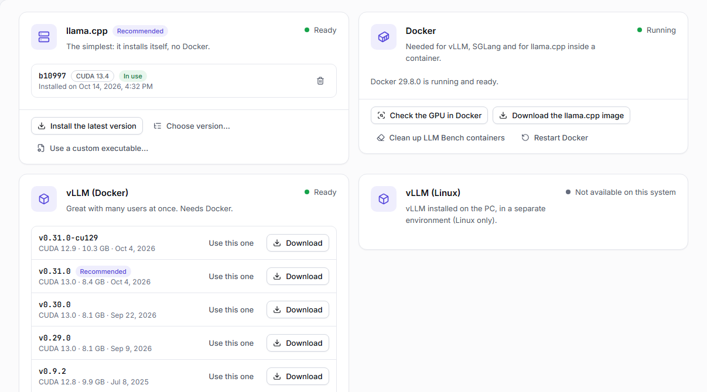
</picture>

- **llama.cpp:** the default. LLM Bench downloads it at the first test; it reads GGUF models.
- **Docker, vLLM and SGLang:** vLLM and SGLang serve many users at once and read Hugging Face folders (safetensors), not GGUF files. On Windows they run in Docker Desktop: if Docker is missing, the Engines page installs it; if it is off, **Start Docker** turns it on. On Linux they run in Docker or installed on the PC, in a Python environment LLM Bench prepares. On Windows, **Copy into Docker storage** copies a model once into Docker's own space, so it loads much faster.
- **When Docker is not responding:** usually Docker Desktop's *Resource Saver* got stuck while stopping. **Restart Docker** restarts it; images, models and containers stay, and LLM Bench's servers come back with the same settings. To avoid it, turn off Resource Saver in Docker Desktop → Settings → Resources → Advanced. LLM Bench never changes Docker's settings itself.
- **Custom engines:** under **Custom engines**, press **Add engine**: a fork of llama.cpp, vLLM or SGLang, a **NInfer variant**, or a **Program with an OpenAI API**. Tell LLM Bench where it is and it tries it (`--version`, `--help`) before using it.
- **NInfer (RTX 5090 only):** an engine made for Qwen 3.6 and 3.8 models on a single RTX 5090, reading `.ninfer` models. It runs on Linux, or inside WSL 2 on Windows. Its card has two builds: the official **NInfer** and **NInfer-all**, which also reads GGUF-NInfer models (LLM Bench picks it by itself when a model needs it). **Download and build** checks what is needed first (git, CMake, a C++ compiler, CUDA…) and lists what is missing with the command to copy. NInfer-all on the RTX 5090 needs **CUDA 13.1 or newer**. Ready-made settings appear on the Benchmark page for `.ninfer` models.

## Settings worth knowing

- **Language:** English or Italiano, also from the globe in the title bar.
- **Real cold measurements:** to measure a true load from disk, the model must not already be in the PC's memory. Linux needs nothing. On Windows, turn it on once in **Settings → Real cold measurements** (Windows asks for administrator permission once). Without it, results carry the note "Cold measurement not guaranteed".
- **Results folder:** choose a shared or synced folder (OneDrive, Syncthing, a network folder) to see the results of several PCs together. Each PC writes its own files, so there are no conflicts.
- **Model folders:** add the folders where you keep models.
- **Expert mode** (on the Benchmark page): set context, GPU layers, flash attention, cache type, batch, threads, parallel requests, extra arguments and environment variables by hand. The **Command preview** always shows the exact line that will run.

## Troubleshooting

| Problem | What to do |
|---|---|
| "NVIDIA driver not installed" or "NVIDIA driver too old" | Press the button that opens NVIDIA's page, install the latest driver and press **Check again** |
| "The graphics memory is in use" | Close other programs using the GPU (games, other models, virtual machines) or press **Continue anyway** |
| "Not enough graphics memory" | Choose a smaller model or a more compressed version; in expert mode, lower the context |
| The model does not fit in video memory (slow test) | Use the q4_0 cache, less context or **Find the best settings** ([details](#when-the-model-does-not-fit-shared-ram)) |
| "The engine did not answer in time" | Try again; if it happens again, the model probably does not fit in video memory: use the q4_0 cache, less context or **Find the best settings** |
| "This version of the engine cannot read the model" | Press **Update** on the engine's card, or use the variant the message suggests (for GGUF-NInfer models: **Download and build NInfer-all, then try again**) |
| "Docker is not running" | Press **Start Docker** |
| "Docker is not responding" | Press **Restart Docker**; to avoid it, turn off Docker Desktop's Resource Saver |
| "You need to accept the model license" | Open the model's page on Hugging Face, accept, and save your token in Settings |
| *Find the best settings* stopped early: time is up | The result keeps what it measured and says why. If the model sits on a Windows folder read through WSL or Docker, move it to the Linux disk (the Engines page tells you how) and search again |

---

The video memory estimate is partly inspired by [llmfit](https://github.com/AlexsJones/llmfit) (MIT license).
